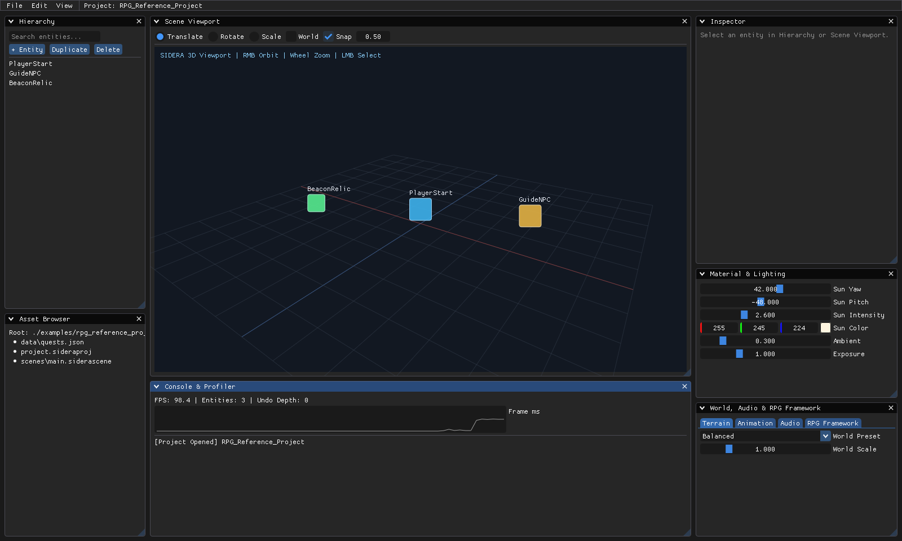

# SIDERA Engine 1.0.0

**SIDERA** is a modular, C++20, CMake-based **Vulkan 1.3** 3D game engine and interactive development platform organized into four cleanly separated layers:

1. **SIDERA Engine Core** (`src/core`, `src/renderer`, `src/scene`, `src/assets`, `src/physics`, `src/audio`, `src/runtime`, `src/memory`, `src/streaming`, `src/profiling`) — including native Vulkan 2D Runtime UI rendering (`src/renderer/UIRenderer.cpp`) with zero Dear ImGui dependency.
2. **Interactive Graphical SIDERA Editor** (`src/editor`) — GLFW + Vulkan + Dear ImGui Docking workspace (Welcome/Project Browser, 3D Scene Viewport with orbit/picking/gizmos/snapping, Hierarchy, Inspector with Undo/Redo, Asset Browser, Material & Lighting, World/Audio/RPG Tools, Console & Profiler).
3. **Reusable Game Frameworks** (`src/framework`) — optional RPG/Adventure systems (Character/Camera, Dialogue/Narrative, Quests, NPCs/Companions, Inventory/Equipment/Attributes/Progression, optional Combat, World Time/Events).
4. **Individual Game Projects** (`examples/rpg_reference_project`) — completely decoupled from Engine Core, buildable into standalone distributable games via `scripts/Build-SideraGame.ps1`.

---

## Interactive SIDERA Editor (`1.0.0`)


---

## Supported Platforms
- **Windows 10/11 x64** — Visual Studio 2022 (MSVC C++20), Vulkan 1.3 GPU (**Verified** on NVIDIA GeForce RTX 4060 Laptop GPU, Vulkan 1.4.341)
- Linux / macOS — *Not yet verified*

---

## Quick Start (Windows PowerShell)
```powershell
$cmake = "C:\Program Files\Microsoft Visual Studio\2022\Community\Common7\IDE\CommonExtensions\Microsoft\CMake\CMake\bin\cmake.exe"
& $cmake -S . -B build
& $cmake --build build --config Release --target sidera sidera_editor test_engine_1_0_release test_rpg_framework -j

# Launch Interactive Graphical SIDERA Editor
.\build\Release\sidera_editor.exe --open-project .\examples\rpg_reference_project

# Launch SIDERA Runtime (Forward+ with live Vulkan 2D Runtime HUD)
Push-Location .\build\Release
.\sidera.exe --render-path forward_plus
Pop-Location

# Build a Standalone Distributable Game
.\scripts\Build-SideraGame.ps1 -ProjectDir .\examples\rpg_reference_project -EngineBinDir .\build\Release -OutputDir .\build\dist_rpg_game
```

---

## Documentation
- **Final Release Notes (`1.0.0`)**: [docs/releases/SIDERA_ENGINE_1_0_0_FINAL.md](docs/releases/SIDERA_ENGINE_1_0_0_FINAL.md)
- **CLI Command Reference**: [docs/guides/SIDERA_CLI_REFERENCE.md](docs/guides/SIDERA_CLI_REFERENCE.md)
- **Build, Run, Package & GitHub Publish Guide**: [docs/guides/SIDERA_BUILD_RUN_AND_PUBLISH_GUIDE.md](docs/guides/SIDERA_BUILD_RUN_AND_PUBLISH_GUIDE.md)
- **End-User Acceptance Test Plan**: [docs/quality/SIDERA_1_0_END_USER_ACCEPTANCE_TEST_PLAN.md](docs/quality/SIDERA_1_0_END_USER_ACCEPTANCE_TEST_PLAN.md)
- **Complete M01–M42 Milestone Audit**: [docs/quality/SIDERA_M01_M42_COMPLETE_MILESTONE_AUDIT.md](docs/quality/SIDERA_M01_M42_COMPLETE_MILESTONE_AUDIT.md)
- **Third-Party Licenses**: [docs/THIRD_PARTY_LICENSES.md](docs/THIRD_PARTY_LICENSES.md)
