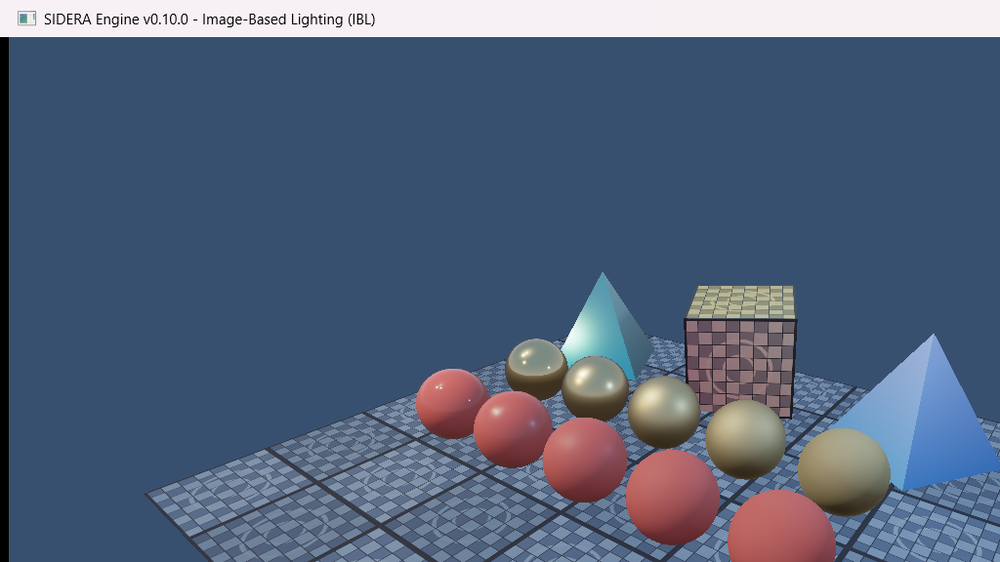
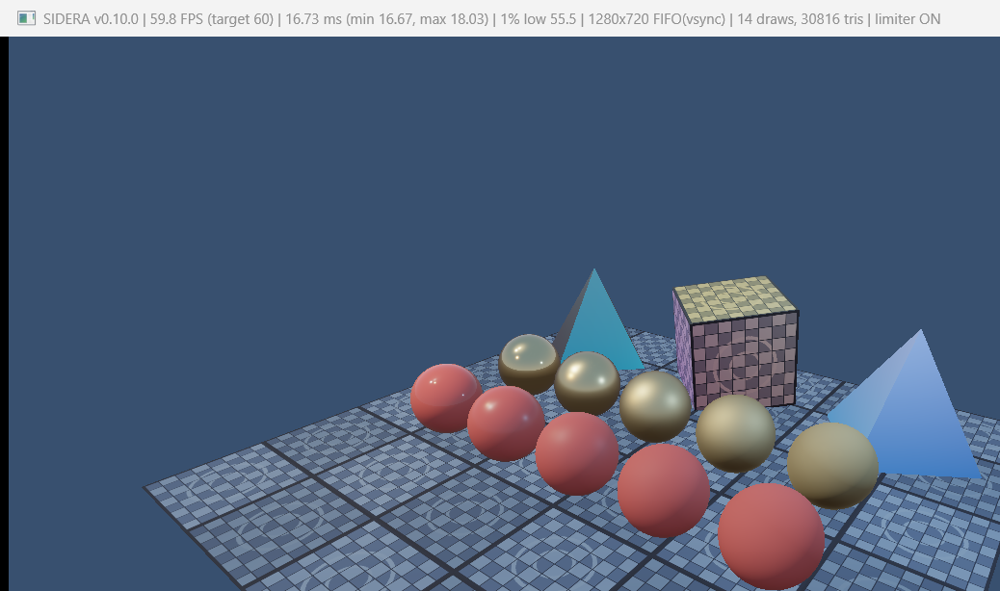

# SIDERA Engine v0.10.0 — Milestone 10: Image-Based Lighting (IBL)

**Status**: COMPLETE (Verified on NVIDIA GeForce RTX 4060 Laptop GPU, Vulkan 1.3)

---

## 1. Overview & Objectives

Milestone 10 introduces a physically based **Image-Based Lighting (IBL)** system into SIDERA Engine, upgrading the Cook-Torrance PBR shading pipeline with realistic ambient lighting and environment reflections derived from HDR environment maps using Epic Games' split-sum approximation.

### Core Deliverables Achieved
1. **HDR Environment Loading & Procedural Fallback**:
   - `stb_image` integration (`stbi_loadf`) for loading `.hdr` Radiance RGBE equirectangular images.
   - Built-in analytical physical HDR sky generator (zenith-to-horizon atmospheric gradient with high-intensity directional sun disc) used seamlessly when no external file is provided.
2. **GPU Compute IBL Precomputation Pipeline (`IBLBuilder`)**:
   - **Pass 1 — Equirectangular to Cubemap** (`equirect_to_cubemap.comp`): Converts 2D equirectangular HDR projection into a 6-face $512 \times 512$ cubemap (`VK_FORMAT_R16G16B16A16_SFLOAT`).
   - **Pass 2 — Diffuse Irradiance Convolution** (`irradiance_convolution.comp`): Cosine-weighted hemisphere integration generating a $32 \times 32$ irradiance cubemap for diffuse ambient lighting.
   - **Pass 3 — Specular Prefiltered Cubemap** (`prefilter_cubemap.comp`): GGX importance sampling over 5 roughness mip levels ($128 \times 128 \to 8 \times 8$) capturing microfacet specular reflections across roughness levels $0.0 \to 1.0$.
   - **Pass 4 — BRDF 2D Integration LUT** (`brdf_lut.comp`): Computes the 2D split-sum scale and bias lookup texture ($512 \times 512$, `VK_FORMAT_R16G16_SFLOAT`).
3. **PBR Fragment Shader Integration (`triangle.frag`)**:
   - Fresnel-Schlick with roughness formulation ($F_{\text{roughness}}$).
   - Energy conservation: $kS = F$, $kD = (1 - kS) \times (1 - \text{metallic})$.
   - Diffuse IBL: $\text{irradiance} \times \text{albedo}$.
   - Specular IBL: $\text{prefilteredColor} \times (F \times \text{lut.r} + \text{lut.g})$.
   - Total ambient: $(kD \times \text{diffuseIBL} + \text{specularIBL}) \times AO$.
   - Reinhard tone mapping and gamma correction.
4. **Vulkan 1.3 Resource Architecture**:
   - New RAII `VulkanCubemap` class managing `VkImage` (`VK_IMAGE_CREATE_CUBE_COMPATIBLE_BIT`), cube `VkImageView`, 2D-array per-mip views for compute storage writes, and trilinear sampler.
   - Support for 16-bit and 32-bit floating-point textures with `VK_IMAGE_USAGE_STORAGE_BIT` in `VulkanTexture`.
   - Descriptor set layout bindings 0 through 4 (UBO, Albedo, Irradiance Cubemap, Prefiltered Cubemap, BRDF LUT).

---

## 2. Visual Results

### PBR Test Scene with Image-Based Lighting

*The scene features gold metallic spheres (back row) demonstrating specular reflections progressing from mirror-like (roughness 0.04) to blurred (roughness 1.0), red dielectric spheres (front row) showing soft diffuse ambient illumination and edge grazing Fresnel, textured dielectric cube, and metallic pyramids.*

### Performance & F3 Statistics (Locked 60 FPS Target)

*Real-time performance running with F3 statistics overlay: **59.8–60.0 FPS** (16.67–16.73 ms frame time, FIFO vsync enabled, frame limiter locked at 60 FPS, 14 draw calls, 30,816 triangles).*

---

## 3. Verification & Acceptance Criteria

| Criteria | Status | Details |
|---|---|---|
| Equirectangular HDR Conversion | **PASS** | $512 \times 512 \times 6$ cubemap generated via compute shader |
| Diffuse Irradiance Convolution | **PASS** | Cosine-weighted hemisphere integration on GPU ($32 \times 32 \times 6$) |
| Specular Prefiltered Cubemap | **PASS** | GGX importance sampling, 5 mip levels ($128 \times 128 \to 8 \times 8$) |
| BRDF 2D Integration LUT | **PASS** | Split-sum approximation $512 \times 512$ $R16G16\_SFLOAT$ |
| PBR Energy Conservation | **PASS** | $kD = (1 - kS) \times (1 - \text{metallic})$ strictly preserved |
| RAII & Memory Cleanliness | **PASS** | All staging buffers, pipelines, descriptors, and cubemaps destroyed cleanly with 0 validation warnings |
| Smoke Test & Stress Loop | **PASS** | 106+ frames rendered during smoke test including window resize, minimize, and restore |
| Performance Target | **PASS** | Stable 60 FPS / 16.67 ms frame time on RTX 4060 Laptop GPU |

---

## 4. Git Commit
- `feat(renderer): implement image-based lighting`
