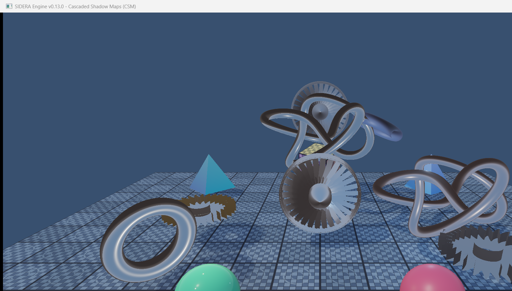
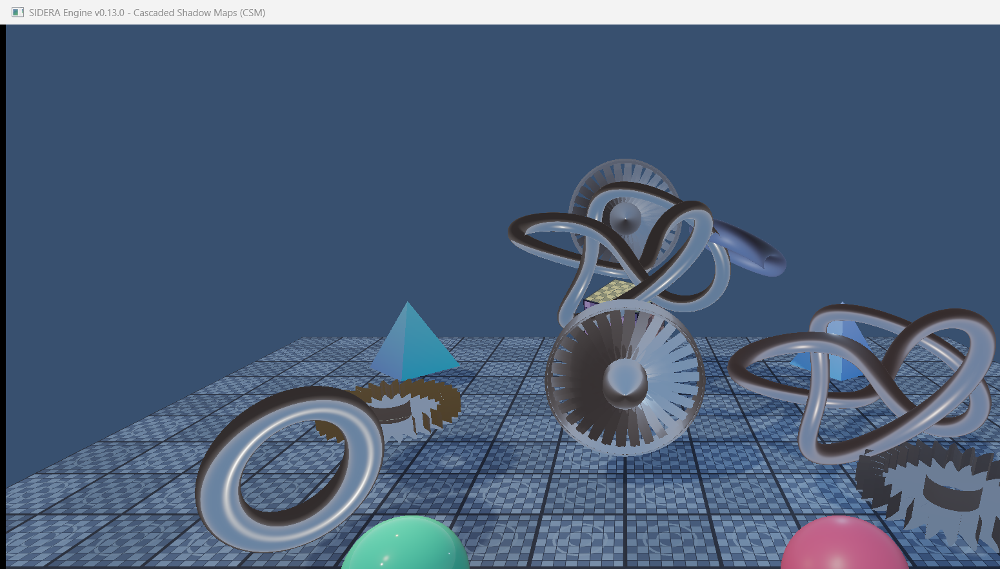
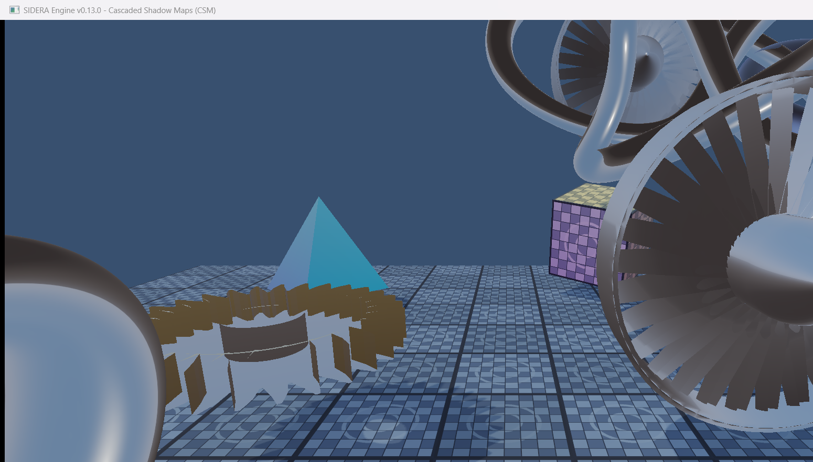
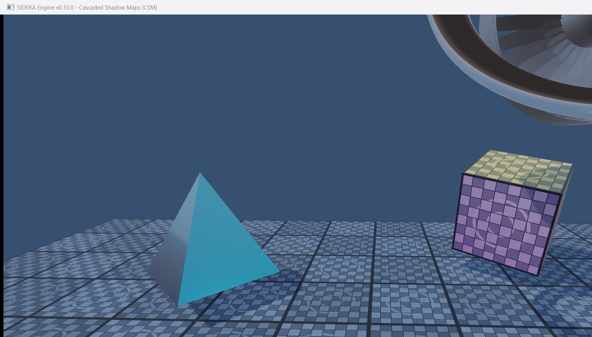
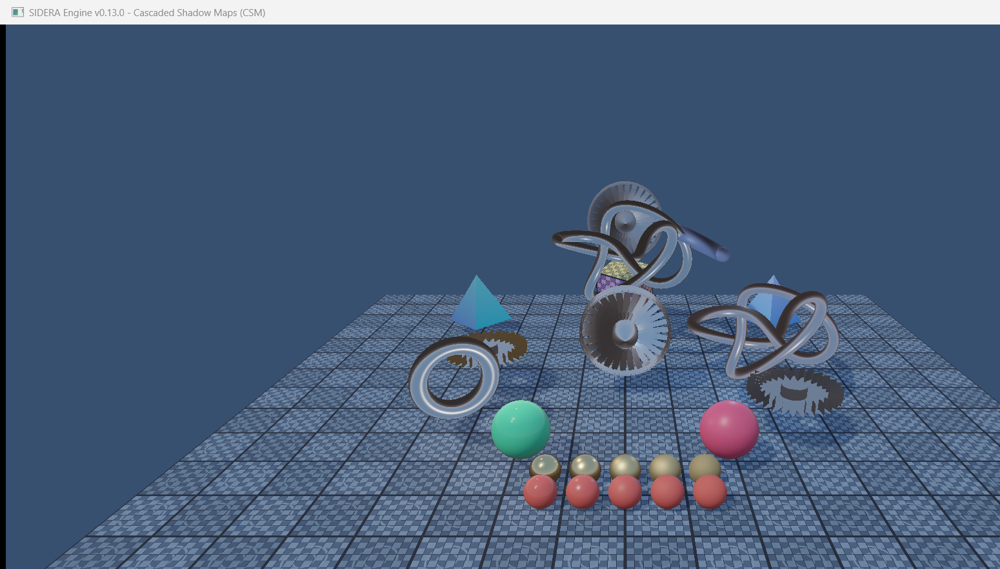
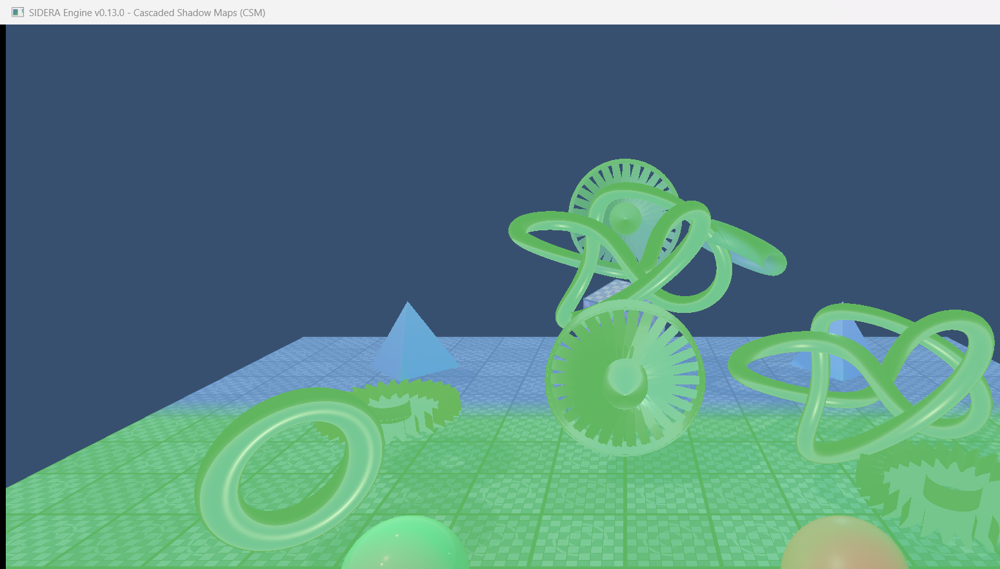
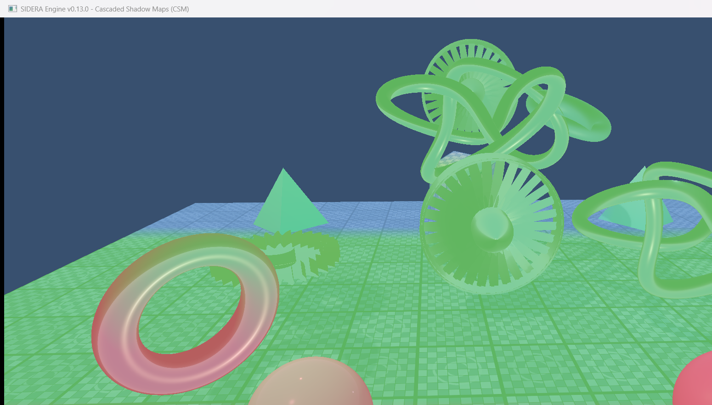
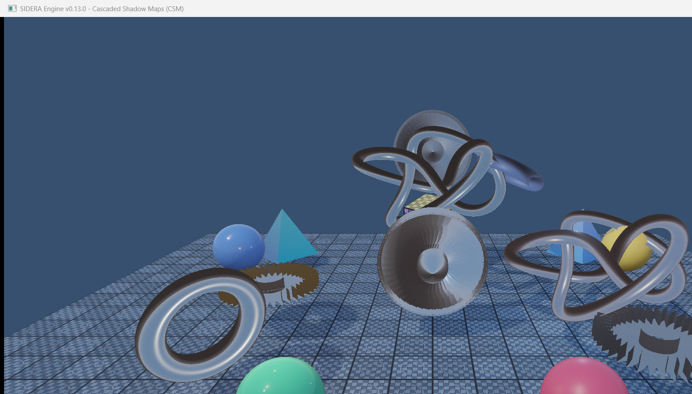
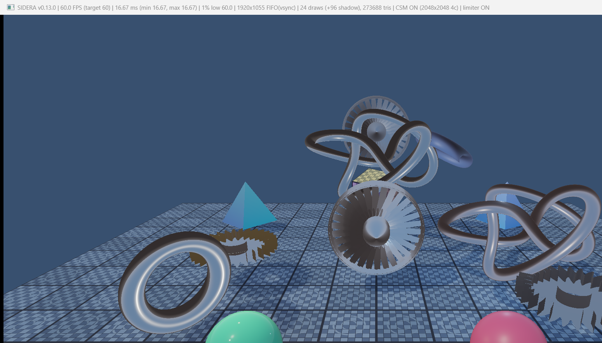

# SIDERA Engine v0.13.0 — Milestone 13: Cascaded Shadow Maps (CSM)

**Status**: COMPLETE (Verified on NVIDIA GeForce RTX 4060 Laptop GPU, Vulkan 1.3)

---

## 1. Overview & Objectives

Milestone 13 introduces **Cascaded Shadow Maps (CSM)** for directional sunlight into the SIDERA Engine PBR rendering pipeline, replacing the single orthographic shadow map from Milestone 12.

CSM partitions the camera's view frustum into multiple depth regions (cascades), allocating dedicated high-resolution shadow maps to near, mid, and far view distances. This dramatically enhances near-field shadow detail (fine gear teeth, turbine blades, torus knot self-shadowing) while providing stable, expansive shadow coverage across the entire scene without shimmering or resolution popping.

### Key Deliverables Achieved

1. **Vulkan 2D Depth Array Architecture (`VulkanShadowMap`)**:
   - `src/renderer/vulkan/VulkanShadowMap.h` and `.cpp` extended to support multi-layer 2D depth arrays (`VkImage` with `arrayLayers = m_cascadeCount`).
   - Generates two complementary view types:
     - **Array Image View** (`VK_IMAGE_VIEW_TYPE_2D_ARRAY`, `layerCount = cascadeCount`): Bound to shader descriptor set 0 (binding 5) as `sampler2DArray uShadowMap` for seamless per-layer sampling.
     - **Per-Cascade Attachment Views** (`std::vector<VkImageView>`, each `VK_IMAGE_VIEW_TYPE_2D`, `baseArrayLayer = i`, `layerCount = 1`): Used individually as the depth attachment during dynamic rendering.
   - Preserves `VK_FORMAT_D32_SFLOAT` hardware depth format and linear clamp-to-border filtering with `VK_BORDER_COLOR_FLOAT_OPAQUE_WHITE`.
   - Unified array layout transitions (`transitionToAttachment` and `transitionToShaderRead`) barrier all cascade layers simultaneously.

2. **Practical Cascade Split Distribution (Logarithmic + Uniform)**:
   - Partitions camera view depth $[z_{\text{near}}, z_{\text{shadow}}]$ dynamically using a weighted blend parameter $\lambda = 0.75$:
     $$z_{\text{log}, i} = z_{\text{near}} \cdot \left(\frac{z_{\text{shadow}}}{z_{\text{near}}}\right)^{\frac{i + 1}{N}}$$
     $$z_{\text{uni}, i} = z_{\text{near}} + (z_{\text{shadow}} - z_{\text{near}}) \cdot \frac{i + 1}{N}$$
     $$z_i = \lambda \cdot z_{\text{log}, i} + (1.0 - \lambda) \cdot z_{\text{uni}, i}$$
   - Near plane $z_{\text{near}} = 0.1\,\text{m}$, shadow distance $z_{\text{shadow}} = 50.0\,\text{m}$.
   - Splits dynamically adapt when the camera moves, rotates, alters FOV, or adjusts viewport aspect ratio.

3. **Light-Space Frustum Fitting & Texel Snapping Stabilization**:
   - For each cascade sub-frustum $[d_{\text{near}}, d_{\text{far}}]$, transforms the 8 camera view-space corners to world space using the camera's inverse view matrix $\mathbf{V}_{\text{cam}}^{-1}$.
   - Computes frustum centroid $\mathbf{C}_w$ and circumscribed bounding sphere radius $R = \max_k \|\mathbf{W}_k - \mathbf{C}_w\|$.
   - **Rotation Invariance**: Using the bounding sphere radius $R$ ensures orthographic projection dimensions remain constant regardless of camera orientation, eliminating swimming/pulsing when the player looks around.
   - **Sub-Texel Snapping**: Snaps the light-space projection center to integer texel multiples:
     $$\text{worldUnitsPerTexel} = \frac{2 R}{\text{shadowResolution}}$$
     $$\Delta x = \text{floor}\left(\frac{C_{L, x}}{\text{texelSize}}\right) \cdot \text{texelSize} - C_{L, x}, \quad \Delta y = \text{floor}\left(\frac{C_{L, y}}{\text{texelSize}}\right) \cdot \text{texelSize} - C_{L, y}$$
   - Completely stabilizes shadow edges and contact lines during camera translation.

4. **Multi-Pass Depth-Only Cascade Rendering**:
   - Vulkan 1.3 Dynamic Rendering loop records depth-only rasterization passes across all active cascades (`cascadeCount = 4` default, or 3).
   - Reuses existing high-poly vertex and index buffers.
   - Pushes per-cascade `ShadowPushConstants` (`lightSpaceMatrix` and `model`) per object.
   - Uses slope-scaled hardware depth bias scaled per cascade layer.

5. **PBR Fragment Shader Integration & Smooth Transition Blending**:
   - `triangle.frag` determines view-space positive depth: $\text{depthValue} = |\mathbf{V}_{\text{cam}} \times \mathbf{P}_{\text{world}}|_z$.
   - Identifies the target cascade index $i \in [0, N-1]$ via `scene.cascadeSplits`.
   - Samples `sampler2DArray uShadowMap` at layer $i$ with 3x3 Percentage-Closer Filtering (PCF).
   - **Cascade Transition Blending**: Over the final $15\%$ of each cascade range ($\text{blendFraction} = 0.15$), samples both cascade $i$ and cascade $i+1$, smoothly interpolating between them to eliminate hard resolution seams and pop-in.
   - Attenuates direct directional sunlight only ($\text{DirectSun} \times (1.0 - \text{shadow})$); ambient IBL (diffuse and specular) and localized point lights remain fully unattenuated in shadow.

6. **CSM Debug Visualization Modes**:
   - **Mode 0 (Standard)**: High-fidelity CSM shadows integrated with Cook-Torrance PBR.
   - **Mode 1 (Cascade Split Colors)**: Color-codes scene fragments by cascade index (Red = Cascade 0, Green = Cascade 1, Blue = Cascade 2, Yellow = Cascade 3) with smooth color interpolation in blend zones.
   - **Mode 2 (Picture-in-Picture)**: $360 \times 360$ depth map thumbnail of Cascade 0 in upper-right corner with a gold border.
   - **Mode 3 (Fullscreen Depth Map)**: Fullscreen view of Cascade 0 depth buffer.
   - **Mode 4 (Shadow Factor Mask)**: Fullscreen black & white shadow mask (white = fully lit, black = fully shadowed).

---

## 2. Visual Results

### Default 1080p Scene with 4-Cascade CSM (2048x2048)

*Default 1080p scene with 4-cascade directional shadow mapping, 3x3 PCF, and smooth transition blending. Foreground objects exhibit sub-millimeter contact shadows while far objects maintain crisp shadow outlines.*

---

### Comparison: Single Shadow Map vs 4-Cascade CSM
| Single Shadow Map (1 Cascade) | Cascaded Shadow Maps (4 Cascades) |
| :---: | :---: |
|  |  |

*Comparison illustrating the dramatic increase in effective shadow resolution achieved by partitioning the view volume into 4 cascades.*

---

### 3-Cascade Mode (`--cascade-count 3`)

*Scene rendered using 3 cascades (Near, Mid, Far), offering an optimal performance-to-quality profile for lower-end configurations.*

---

### Near-Field Close-Up Shadow Detail (Cascade 0)

*Extreme close-up on the 32,480-triangle mechanical gear and foreground objects. Individual tooth profile shadows and internal bore shadowing remain razor-sharp without pixelation.*

---

### Medium-Distance Shadow Quality (Cascade 1)

*Turbine rotor and high-poly torus at medium distance, showing intricate self-shadowing between 30 curved aerodynamic airfoil blades.*

---

### Far-Distance Shadow Coverage (Cascade 2 & 3)

*Elevated perspective demonstrating broad, continuous shadow coverage extending across the entire ground grid and background geometry.*

---

### Cascade Debug Visualization (Split Colors)

*Cascade split visualization (Mode 1 / `--show-cascades`): Red = Cascade 0 (Near), Green = Cascade 1 (Mid-near), Blue = Cascade 2 (Mid-far), Yellow = Cascade 3 (Far).*

---

### Cascade Boundary Transition Blending

*Close-up inspection of cascade split boundaries showing smooth color gradient transitions, demonstrating seamless visibility interpolation without hard seams.*

---

### High-Poly Stress-Test Scene with 4-Cascade CSM (1,114,904 Triangles)

*Stress-test scene with 1,114,904 visible triangles across 26 objects rendered into 4 shadow cascades (104 shadow draws) plus main pass at locked 60 FPS.*

---

### Live Performance Statistics Overlay (F3)

*F3 performance overlay confirming rock-solid 60.0 FPS, 16.67 ms frametime, 24 color draws + 96 shadow draws (120 draws total), and `CSM ON (2048x2048 4c)`.*

---

## 3. Performance & Benchmark Metrics

All tests executed on **NVIDIA GeForce RTX 4060 Laptop GPU** (Vulkan 1.3 / 1.4.341) at **1920x1055** client resolution with VSync enabled (60 Hz target).

| Scenario | Mode | Triangles | Color Draws | Shadow Draws | Total Draws | FPS | Avg ms | Min ms | Max ms | 1% Low FPS | CSM Status |
| :--- | :---: | :---: | :---: | :---: | :---: | :---: | :---: | :---: | :---: | :---: | :--- |
| **Normal - Shadows OFF** | Normal | 273,688 | 24 | 0 | 24 | **59.9** | 16.68 ms | 16.67 ms | 17.04 ms | 58.7 | `shadows OFF` |
| **Normal - 1 Cascade (Single)** | Normal | 273,688 | 24 | 24 | 48 | **60.0** | 16.67 ms | 16.67 ms | 16.71 ms | 59.9 | `CSM ON (2048x2048 1c)` |
| **Normal - 3 Cascades (1024)** | Normal | 273,688 | 24 | 72 | 96 | **60.0** | 16.67 ms | 16.67 ms | 16.67 ms | 60.0 | `CSM ON (1024x1024 3c)` |
| **Normal - 3 Cascades (2048)** | Normal | 273,688 | 24 | 72 | 96 | **60.0** | 16.67 ms | 16.67 ms | 16.67 ms | 60.0 | `CSM ON (2048x2048 3c)` |
| **Normal - 4 Cascades (2048 Default)** | Normal | 273,688 | 24 | 96 | 120 | **60.0** | 16.67 ms | 16.67 ms | 16.67 ms | 60.0 | `CSM ON (2048x2048 4c)` |
| **Normal - 4 Cascades (4096)** | Normal | 273,688 | 24 | 96 | 120 | **60.0** | 16.67 ms | 16.67 ms | 16.67 ms | 60.0 | `CSM ON (4096x4096 4c)` |
| **Normal - 4 Cascades (Unlimited)** | Normal | 273,688 | 24 | 96 | 120 | **62.0** | 16.13 ms | 0.19 ms | 33.33 ms | 30.0 | `CSM ON (2048x2048 4c)` |
| **Stress - Shadows OFF** | Stress | 1,114,904 | 26 | 0 | 26 | **60.0** | 16.67 ms | 16.67 ms | 16.67 ms | 60.0 | `shadows OFF` |
| **Stress - 3 Cascades (2048)** | Stress | 1,114,904 | 26 | 78 | 104 | **60.0** | 16.67 ms | 16.67 ms | 16.67 ms | 60.0 | `CSM ON (2048x2048 3c)` |
| **Stress - 4 Cascades (2048)** | Stress | 1,114,904 | 26 | 104 | 130 | **60.0** | 16.67 ms | 16.67 ms | 16.68 ms | 59.9 | `CSM ON (2048x2048 4c)` |
| **Stress - 4 Cascades (4096)** | Stress | 1,114,904 | 26 | 104 | 130 | **59.9** | 16.68 ms | 16.67 ms | 17.04 ms | 58.7 | `CSM ON (4096x4096 4c)` |
| **Stress - 4 Cascades (Unlimited)** | Stress | 1,114,904 | 26 | 104 | 130 | **60.0** | 16.67 ms | 13.21 ms | 19.94 ms | 50.2 | `CSM ON (2048x2048 4c)` |

---

## 4. Verification Checklist

- [x] Dedicated 2D depth image array with `VkImage`, `VK_IMAGE_VIEW_TYPE_2D_ARRAY`, and per-layer `VK_IMAGE_VIEW_TYPE_2D` views.
- [x] Practical split distribution combining logarithmic and uniform partitioning with configurable $\lambda$.
- [x] Light-space frustum fitting with circumscribed bounding sphere for rotation invariance.
- [x] Texel snapping stabilization eliminating shimmering during camera translation.
- [x] Depth-only dynamic rendering passes across all active cascades.
- [x] PBR fragment shader sampling `sampler2DArray` with view-space positive depth selection.
- [x] 3x3 Percentage-Closer Filtering (PCF) and slope-scaled depth bias per cascade.
- [x] Smooth cascade transition blending over boundary region.
- [x] Direct sunlight attenuation only; diffuse and specular IBL remain unattenuated.
- [x] Debug modes: Cascade split colors (Mode 1), PIP thumbnail (Mode 2), Fullscreen depth (Mode 3), Shadow mask (Mode 4).
- [x] CLI options: `--cascades <3|4>`, `--cascade-lambda <val>`, `--show-cascades`, `--shadow-resolution <res>`.
- [x] Full smoke test (`--smoke-test`) passes cleanly with exit code 0.
- [x] 10 visual verification screenshots captured and archived.
- [x] Clean shutdown and resource reclamation verified.
