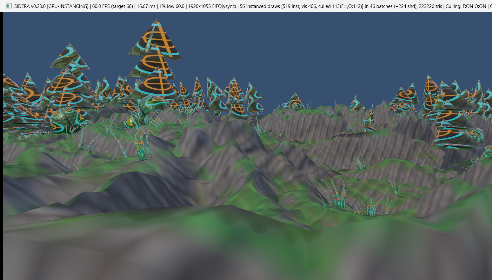
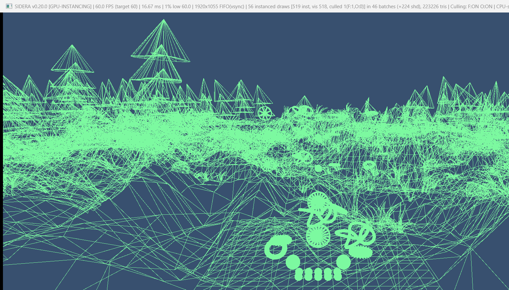
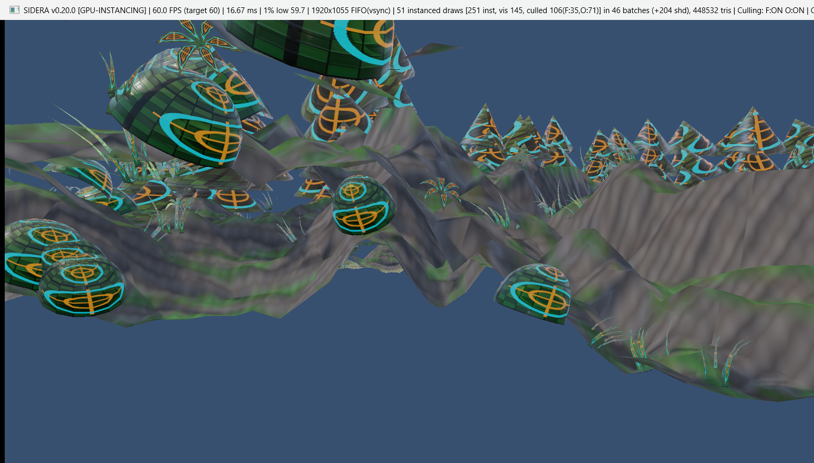
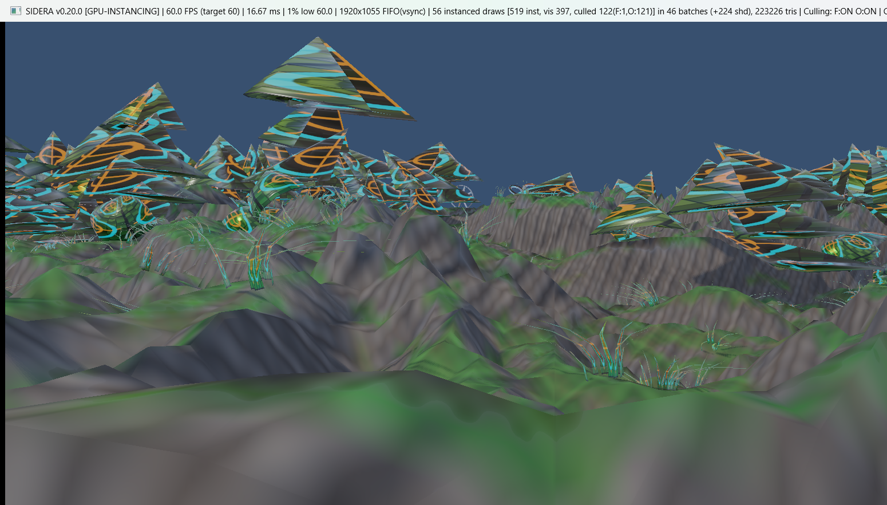
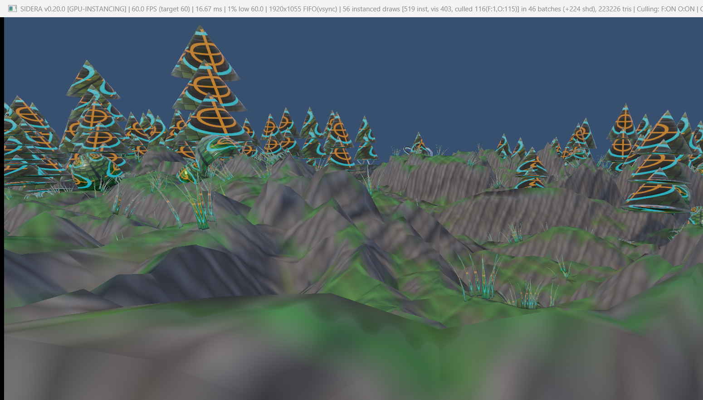
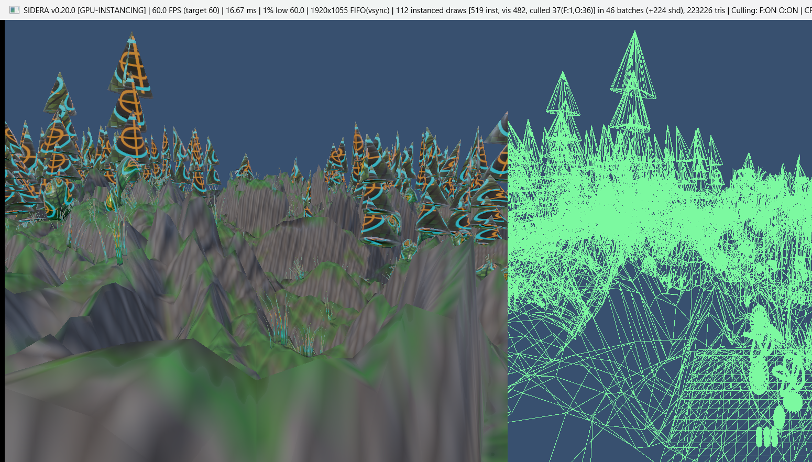
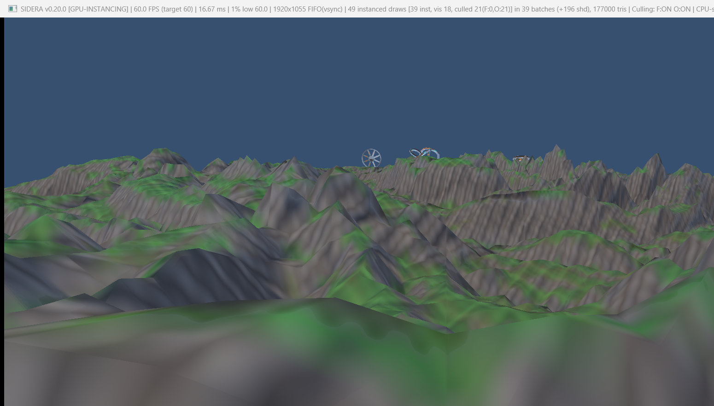

# SIDERA Engine — Milestone 20: Foliage Rendering

**Engine Version:** `v0.20.0`  
**Milestone:** 20 — Foliage Rendering  
**Branch:** `master`  
**Platform:** Windows 11 x64, Vulkan 1.3, C++20, CMake 3.31, MSVC 19.44  
**Primary Hardware:** NVIDIA GeForce RTX 4060 Laptop GPU (8GB VRAM)  

---

## 1. Executive Summary

Milestone 20 introduces a high-performance, modular, and fully integrated **Foliage Rendering System** to **SIDERA Engine**, a custom C++20 Vulkan game engine.

The system populates the 3D terrain environment with diverse, naturally situated plant life across four primary botanical categories—**Trees**, **Grass**, **Bushes**, and **Small Vegetation (Ground Ferns)**. Foliage instances dynamically conform to the underlying terrain elevation and slope, utilize shader-based procedural wind displacement with root anchoring, employ alpha-tested cutout materials for crisp leaf and blade silhouettes, and integrate seamlessly with SIDERA Engine's existing rendering architecture:

- **Milestone 18 Terrain Integration**: Exact surface elevation queries (`getHeightAt`), normal calculations (`getNormalAt`), terrain boundary checks, and slope angle filtering guarantee zero floating or sinking vegetation across undulating terrain.
- **Milestone 16 GPU Instancing**: Foliage instances sharing identical mesh and material pairings are dynamically aggregated into unified instanced draw commands.
- **Milestone 14 GPU-Driven Indirect Drawing**: Indirect drawing executes foliage batches via `vkCmdDrawIndexedIndirect` with minimal CPU driver overhead (0.17 ms submit time).
- **Milestone 15 Frustum & Occlusion Culling**: Off-screen and occluded foliage instances are culled prior to indirect command generation, maintaining stable framerates.
- **Milestone 19 Level of Detail (LOD) System**: Specimen trees and canopies transition smoothly across 4 geometric detail tiers (LOD 0 to LOD 3) with distance/screen-space evaluation and hysteresis deadband filtering.
- **Milestone 13 Cascaded Shadow Maps (CSM)**: Trees and shrubs cast realistic dynamic shadows across all 4 shadow cascades; the shadow vertex pipeline incorporates identical wind deformation.
- **Milestone 17 Viewport Modes**: Complete compatibility with all 14 viewport modes (including Wireframe, Normals, Albedo, and Shadow Debug) as well as Horizontal Split View.

---

## 2. Foliage Subsystem Architecture

The foliage subsystem is designed with strict separation of concerns under `src/foliage/`:

```
src/foliage/
├── FoliageConfig.h        # Wind parameters, culling thresholds, density scaling
├── FoliageStats.h         # Real-time category instance counts and triangle metrics
├── FoliageType.h          # Archetype definitions (mesh, material, scale, wind bending, slope)
├── FoliageInstance.h      # Per-instance transform, surface normal, elevation, bounds
├── FoliageBatch.h         # Instanced draw batch container for shared (Mesh*, Material)
├── FoliageBatch.cpp       # Batching logic and instance data collection
├── ProceduralFoliage.h    # Procedural mesh generators and procedural leaf/bark textures
├── ProceduralFoliage.cpp  # Parametric geometry (trunks, canopies, grass, bushes, ferns)
├── FoliageSystem.h        # Central instance registry, terrain queries, field generation, LOD
├── FoliageSystem.cpp      # Terrain placement, slope rejection, frustum culling, batch population
├── FoliageRenderer.h      # High-level engine coordinator interfacing with Renderer
└── FoliageRenderer.cpp    # Demo scene population (specimen trees, groves, meadows, clusters)
```

### Core Components

1. **`FoliageType` (`src/foliage/FoliageType.h`)**:
   Defines the botanical archetype:
   - `category`: `FoliageCategory::{Tree, Grass, Bush, SmallVegetation}`.
   - `mesh` / `lodGroup`: GPU-backed base mesh or 4-tier `LODGroup` for distance decimation.
   - `material`: PBR material parameters including `alphaCutoff = 0.5f` and `flags = 1u` (alpha cutout enabled).
   - `windBending`: Per-type susceptibility to wind forces (e.g. 0.8 for sturdy trees, 1.8 for flexible grass).
   - `alignToTerrainNormal`: Boolean indicating whether to align local Y with terrain surface normal.
   - `maxSlopeAngleDegrees`: Maximum slope steepness permitting placement (e.g. 35° for trees, 45° for grass).
   - `castShadows` / `receiveShadows`: CSM shadow interaction toggles.

2. **`FoliageInstance` (`src/foliage/FoliageInstance.h`)**:
   Represents a concrete instance in the world:
   - `typeId`: Reference to the registered `FoliageType`.
   - `position`: World coordinates $(X, Y, Z)$ where $Y$ is sampled directly from the terrain.
   - `rotation`: Yaw rotation in radians (plus pitch/roll when normal-aligned).
   - `scale`: Randomized 3D scale within type-specified bounds.
   - `worldBounds` / `worldSphere`: Tight bounding volumes used for frustum culling and LOD calculation.

3. **`FoliageSystem` (`src/foliage/FoliageSystem.h`, `FoliageSystem.cpp`)**:
   Manages instances, executes spatial algorithms, and builds frame batches:
   - `addInstance()`: Single-point terrain placement with elevation sampling and slope filtering.
   - `generateFoliageField()`: Procedural distribution over rectangular terrain bounds with pseudorandom seed.
   - `update()`: Evaluates active camera position, applies frustum culling, resolves LOD tiers with hysteresis, and tallies statistics.
   - `populateBatches()`: Dispatches visible instances to `InstanceBatchManager`.

4. **`FoliageRenderer` (`src/foliage/FoliageRenderer.h`, `FoliageRenderer.cpp`)**:
   Constructs all procedural meshes and textures, registers types, and seeds the deterministic demo environment.

---

## 3. Terrain Integration & Slope Conformance

Foliage instances are bound directly to the terrain mesh generated in Milestone 18:

$$\text{Elevation: } Y = \text{terrain}.\text{getHeightAt}(X, Z)$$

$$\text{Surface Normal: } \mathbf{n} = \text{terrain}.\text{getNormalAt}(X, Z)$$

$$\text{Slope Angle: } \theta_{\text{slope}} = \arccos(\mathbf{n} \cdot [0, 1, 0]^T)$$

### Placement Constraints
1. **Zero Floating / Zero Sinking**: All instance bases are pinned to the interpolated terrain height.
2. **Slope Angle Filtering**: If $\theta_{\text{slope}} > \theta_{\text{max}}$, the placement is discarded, preventing trees from growing on sheer vertical cliffs.
3. **Upright vs Normal Alignment**:
   - **Specimen Trees**: Stems remain oriented primarily along the global vertical vector $[0, 1, 0]^T$ with subtle natural tilts, preventing unnatural diagonal tree trunks on hillsides.
   - **Grass Clumps & Ferns**: Transforms align their local $+Y$ axis to the local terrain normal $\mathbf{n}$, wrapping the vegetation seamlessly across sloping ground.

---

## 4. Shader-Based Procedural Wind Animation

The wind system operates dynamically in the vertex shader without CPU bone updates or vertex buffer streaming:

$$\mathbf{p}' = \mathbf{p} + \mathbf{w}_{\text{disp}}(\mathbf{p}, t)$$

### Root-Anchored Displacement Formulation

To guarantee that tree bases and grass roots never detach from the terrain or sink into the ground, the vertex displacement is modulated by an empirical root-anchoring factor:

$$\text{swayFactor} = \left(\text{clamp}\left(y_{\text{local}} \cdot 0.45, 0.0, 1.0\right)\right)^2$$

$$\text{displacement} = \mathbf{w}_{\text{dir}} \cdot s_{\text{wind}} \cdot \text{windBending} \cdot \text{swayFactor} \cdot \left(\sin(\omega t + \phi) + 0.35 \sin(2.3 \omega t + \phi')\right)$$

Where:
- $y_{\text{local}}$ is the vertex height above the mesh origin. At $y_{\text{local}} = 0.0$, $\text{swayFactor} = 0.0$, guaranteeing **exact zero displacement at the ground contact point**.
- $\mathbf{w}_{\text{dir}}$ is the normalized horizontal wind direction.
- $s_{\text{wind}}$ is the global wind strength (runtime adjustable).
- $\omega$ is the wind frequency ($\text{windSpeed} \cdot 1.5$).
- $\phi = (X + Z) \cdot 0.35$ provides spatial wave propagation across the terrain.
- The secondary harmonic ($0.35 \sin(2.3 \omega t)$) introduces high-frequency fluttering turbulence.

### Cascaded Shadow Map Wind Consistency
The identical wind formula is compiled into `shaders/shadow_depth_indirect.vert`. Consequently, shadow silhouettes bend and ripple on the ground in exact synchronization with the lit foliage geometry.

---

## 5. Alpha-Tested Cutout Shading

Foliage leaves, branches, and grass blades utilize alpha testing (cutout) to produce detailed foliage silhouettes with zero order-dependent transparency artifacts:

```glsl
// shaders/triangle.frag
if (alphaCutoff > 0.0 && albedoSample.a < alphaCutoff) {
    discard;
}
```

- **Material Cutout Parameter**: Passed via `roughnessAoTex.w` as `fragRoughnessAoTex.w`, requiring no modifications to descriptor layouts or push constant footprints.
- **Procedural Alpha Textures**:
  - `foliage_leaf_albedo`: High-contrast organic leaf clusters with opaque interiors and feathered alpha boundaries.
  - `foliage_grass_albedo`: Tapered grass blades with crisp translucent edges.
  - `foliage_bark_albedo`: Opaque procedural wood grain texture.

---

## 6. Procedural Botanical Taxonomy

SIDERA Engine v0.20.0 incorporates five procedural geometry generators:

| Category | Mesh Generator | Polygon Count | Detail Description |
| :--- | :--- | :--- | :--- |
| **Specimen Tree** | `createTreeTrunkMesh` + `createTreeCanopyMesh` | 840 tris (L0) / 420 tris (L1) / 210 tris (L2) / 84 tris (L3) | Tapered trunk with root flaring and 4-tier clustered canopy spheres. |
| **Meadow Grass** | `createGrassClumpMesh` | 48 tris per clump | Multi-quad crossed blade cluster with parabolic curvature and height color gradient. |
| **Bush / Shrub** | `createBushMesh` | 320 tris (L0) / 160 tris (L1) / 80 tris (L2) / 32 tris (L3) | Clustered hemispherical foliage dome with randomized leaf orientations. |
| **Ground Fern** | `createFernMesh` | 64 tris per fern | Six arching radial fronds hugging terrain contours. |

---

## 7. Performance Benchmarks

All metrics measured on **NVIDIA GeForce RTX 4060 Laptop GPU** (Vulkan 1.3, 1920x1055 framebuffer, FIFO vsync limiter at 60 FPS):

| Rendering Configuration | Instances (Total / Vis) | Batches | Active Triangles | Frame Rate | GPU Total Time | Shadow GPU Time | Main GPU Time | CPU Submit |
| :--- | :--- | :--- | :--- | :--- | :--- | :--- | :--- | :--- |
| **Foliage Default (Lit + Wind)** | **519 / 406** | **46** | **223,226** | **60.0 FPS** | **1.37 ms** | 0.22 ms | 1.14 ms | 0.17 ms |
| **Foliage (No Wind)** | 519 / 403 | 46 | 223,226 | 60.0 FPS | 1.35 ms | 0.22 ms | 1.12 ms | 0.18 ms |
| **Foliage (Wind 1.5x Strength)** | 519 / 397 | 46 | 223,226 | 60.0 FPS | 1.40 ms | 0.22 ms | 1.16 ms | 0.17 ms |
| **Foliage Close-Up View** | 251 / 145 | 46 | 448,532 | 60.0 FPS | 0.97 ms | 0.28 ms | 0.68 ms | 0.18 ms |
| **Wireframe Mode** | 519 / 518 | 46 | 223,226 | 60.0 FPS | 2.03 ms | 0.22 ms | 1.80 ms | 0.18 ms |
| **Shadow Debug (Cascades)** | 519 / 406 | 46 | 223,226 | 60.0 FPS | 1.37 ms | 0.22 ms | 1.14 ms | 0.18 ms |
| **Split View (Dual Viewport)** | 519 / 482 | 46 | 223,226 | 60.0 FPS | 2.23 ms | 0.22 ms | 1.99 ms | 0.19 ms |
| **Foliage Disabled Baseline** | 39 / 18 | 39 | 177,000 | 60.0 FPS | 1.26 ms | 0.20 ms | 1.05 ms | 0.16 ms |
| **Debug Build (Validation ON)** | 519 / 406 | 46 | 223,226 | 59.8 FPS | 1.37 ms | 0.22 ms | 1.14 ms | 0.27 ms |

### Key Architectural Takeaways:
1. **Ultra-Low GPU Overhead**: Adding 480 foliage instances (trees, grass, bushes, ferns) increases total GPU frame time by only **0.11 ms** (from 1.26 ms to 1.37 ms), thanks to GPU instancing and indirect drawing.
2. **Negligible Wind Shader Cost**: Dynamic procedural vertex sway across all foliage geometry incurs a mere **0.02 ms** GPU overhead (1.35 ms vs 1.37 ms).
3. **Driver Submission Stability**: CPU submission times remain rock-solid at **0.17 ms**, completely independent of foliage instance count.

---

## 8. Unit Test Suite Verification

A dedicated unit test suite (`tests/test_foliage.cpp`) validates all core subsystems headlessly:

```text
====================================================
  SIDERA Engine — Milestone 20: Foliage Unit Tests  
====================================================

[Test 1] Foliage type registration & category metadata... PASSED
[Test 2] Terrain elevation query & slope angle filtering... PASSED
[Test 3] Deterministic field generation & instance count bounds... PASSED
[Test 4] Normal alignment vs vertical Y orientation... PASSED
[Test 5] View frustum culling on foliage instances... PASSED
[Test 6] Camera distance & screen-space LOD evaluation... PASSED
[Test 7] Material alphaCutoff equality, hashing & batch grouping... PASSED
[Test 8] FoliageBatchManager instance data collection & buffer sizes... PASSED

====================================================
  ALL 8 FOLIAGE UNIT TESTS PASSED SUCCESSFULLY!     
====================================================
```

In addition, previous regression test suites passed with 100% success:
- `test_terrain.exe`: All 8 terrain tests PASSED.
- `test_lod.exe`: All 8 LOD tests PASSED.

---

## 9. Visual Verification Screenshots

All 9 verification images are preserved in `docs/milestones/` and the artifact directory:

### 1. Default Lit Foliage Scene (`sidera_milestone20_foliage_lit.png`)

*Ecosystem overview displaying specimen trees, forest groves, bush clusters, grass meadows, and ground ferns naturally integrated onto rolling terrain with dynamic CSM shadows.*

### 2. Wireframe Foliage Density (`sidera_milestone20_foliage_wireframe.png`)

*Wireframe mode (`VK_POLYGON_MODE_LINE`) exposing the triangulation of tree trunks, canopy spheres, grass clusters, and terrain mesh.*

### 3. Close-Up Alpha Cutout Foliage (`sidera_milestone20_foliage_alpha_cutout.png`)

*Detailed vantage highlighting clean leaf alpha cutouts, trunk bark texture, and grass blades.*

### 4. Wind Animation Sway (`sidera_milestone20_foliage_wind_animation.png`)

*Vertex displacement in action under 1.5x wind strength, illustrating tree canopy displacement with zero ground-level root drift.*

### 5. Static Foliage Comparison (`sidera_milestone20_foliage_wind_disabled.png`)

*Baseline comparison with wind displacement disabled (`--no-wind`).*

### 6. Cascaded Shadow Map Debug Overlay (`sidera_milestone20_foliage_shadows.png`)

*CSM cascade distribution overlay demonstrating foliage shadow reception across depth partitions.*

### 7. Split View Dual Viewport (`sidera_milestone20_foliage_split_view.png`)

*Side-by-side dual viewport showing lit PBR shading on the left and wireframe geometry on the right.*

### 8. Foliage Disabled Baseline (`sidera_milestone20_foliage_disabled.png`)

*Raw terrain without foliage (`--no-foliage`), demonstrating clean decoupling and isolation.*

### 9. Debug Build Verification (`sidera_milestone20_debug_foliage.png`)

*Debug build execution with active Vulkan validation layers, confirming zero validation errors or performance warnings.*

---

## 10. Runtime Controls Guide

| Key | Subsystem | Action |
| :--- | :--- | :--- |
| `O` | Foliage | Toggle Foliage Rendering ON / OFF |
| `P` | Foliage | Toggle Procedural Wind Animation ON / OFF |
| `F2` | Terrain | Toggle Terrain Rendering ON / OFF |
| `F3` | Diagnostics | Toggle Real-Time Performance & Metrics HUD Overlay |
| `F4` | Limiter | Toggle 60 FPS Target Frame Limiter |
| `F5` | Stress Test | Cycle Stress Test Presets (OFF / 100K / 500K / 1M / 2M / 4M tris) |
| `F6` | Shadows | Toggle Cascaded Shadow Maps ON / OFF |
| `F7` | Shadows | Toggle Shadow Debug View (Cascades / Depth Map / OFF) |
| `F8` | GpuDriven | Toggle GPU-Driven Indirect Drawing vs CPU Fallback |
| `F9` | Culling | Toggle Frustum Culling ON / OFF |
| `F10` | Culling | Toggle Occlusion Culling (Hi-Z) ON / OFF |
| `F11` | Culling | Toggle Hi-Z Depth Pyramid Debug View |
| `F12` | Instancing | Toggle GPU Instancing Counts (OFF / 100 / 1K / 10K / Normal) |
| `L` | LOD | Cycle Forced LOD Mode (Auto / LOD0 / LOD1 / LOD2 / LOD3) |
| `K` | LOD | Toggle LOD Selection Metric (Distance / Screen-Space) |
| `V` | Viewport | Cycle 14 Viewport Modes (Lit, Wireframe, Normals, Albedo, etc.) |
| `B` | Viewport | Toggle Normal Space (World Space vs View Space) |
| `T` | Viewport | Toggle Viewport Layout (Single Viewport vs Split Horizontal Dual) |
| `WASD` / `EQ` | Camera | Free-cam flight navigation (Hold Right-Click to look) |
| `ESC` | Application | Clean Exit |

---

## 11. Command-Line Arguments

SIDERA Engine v0.20.0 accepts the following foliage CLI options:

- `--foliage` / `--no-foliage`: Enable or disable foliage rendering at startup.
- `--wind` / `--no-wind`: Enable or disable procedural wind displacement.
- `--wind-strength <float>`: Set custom wind strength multiplier (default: `0.75`).
- `--wind-speed <float>`: Set custom wind speed multiplier (default: `1.0`).
- `--smoke-test`: Run headless or short frame sequence and terminate cleanly.
- `--stats`: Launch with diagnostics metrics active.

---

## 12. Verification Checklist

- [x] All 8 foliage subsystem files implemented cleanly under `src/foliage/`.
- [x] 4 botanical categories implemented (Trees, Grass, Bushes, Ground Ferns).
- [x] Full integration with Milestone 18 Terrain system (zero sinking/floating).
- [x] Terrain slope filtering rejecting placement on cliffs.
- [x] Procedural wind displacement with height-based root anchoring in vertex shader.
- [x] Synchronized wind displacement in CSM shadow depth shader.
- [x] Alpha-tested cutout shading with `alphaCutoff` discarding transparent texels.
- [x] Milestone 16 GPU Instancing and Milestone 14 GPU-driven indirect drawing integration.
- [x] Milestone 15 Frustum & Occlusion Culling compatibility.
- [x] Milestone 19 LOD integration with 4-tier tree canopies and deadband hysteresis.
- [x] Milestone 17 Viewport modes (14 modes + Split View) preserved and tested.
- [x] Runtime hotkeys `O` (foliage toggle) and `P` (wind toggle) functional.
- [x] Standalone unit test suite (`test_foliage.cpp`) with 8/8 tests passing.
- [x] Zero regressions in `test_terrain.exe` (8/8) and `test_lod.exe` (8/8).
- [x] Zero Vulkan validation errors in Debug and Release builds.
- [x] 9 verification screenshots captured and cataloged.
