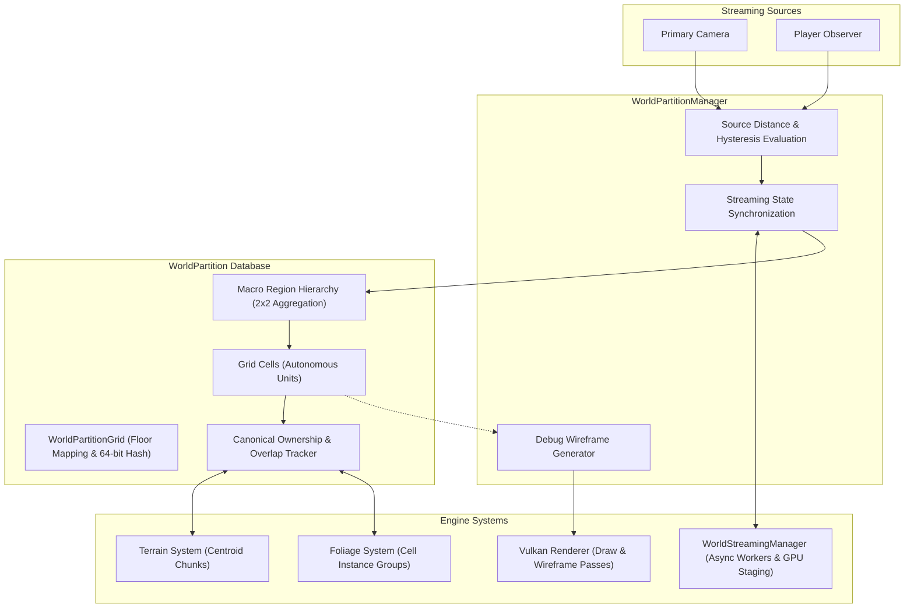

# SIDERA Engine — Milestone 22: World Partition System

**Engine Version:** `v0.22.0`  
**Milestone:** 22 — World Partition System  
**Branch:** `master`  
**Platform:** Windows 11 x64, Vulkan 1.3, C++20, CMake 3.31, MSVC 19.44  
**Primary Hardware:** NVIDIA GeForce RTX 4060 Laptop GPU (8GB VRAM)  

---

## 1. Executive Summary

Milestone 22 introduces a scalable, production-grade **World Partition System** to **SIDERA Engine**, a custom C++20 Vulkan game engine.

Building upon the asynchronous streaming infrastructure created in Milestone 21, the World Partition System delivers deterministic spatial indexing, multi-level macro hierarchical organization, canonical entity ownership with boundary-spanning overlap tracking, and high-performance deduplicated spatial queries across massive environments.



### Key Architectural Highlights
- **Mathematical Continuous Grid Partitioning**: Robust 2D grid partitioning (`WorldPartitionGrid`) with configurable cell size ($30\text{ m}$ default) utilizing `std::floor` division. This mathematically eliminates negative coordinate truncation collapse around $(0,0)$ and guarantees seamless infinite-world indexing.
- **Bijective 64-bit Cell IDs**: Fully reversible, collision-free 64-bit hashing mapping 2D integer cell coordinates $(c_x, c_z) \in \mathbb{Z}^2$ into a unique unsigned 64-bit key via standard integer bit-interleaving / packing.
- **Hierarchical Macro Regions**: Groups cells into $2 \times 2$ macro cells ($60\text{ m} \times 60\text{ m}$ by default), accelerating broadphase spatial queries and frustum intersection tests before descending into granular cell checks.
- **Canonical Object Ownership & Overlap Tracking**: Resolves the fundamental dual problem of spatial partitioning:
  - **No Duplicate Rendering**: Every object is assigned to a single *canonical owner cell* based on its bounding box centroid. Objects are rendered strictly once when their owner cell is active.
  - **No Missed Spatial Queries**: Objects whose bounding volumes span multiple cell boundaries are simultaneously registered as *overlapping references* in neighboring cells, ensuring comprehensive boundary coverage for radius, box, and frustum tests.
- **Subsystem Integration Without Duplication**:
  - **World Streaming (M21)**: Coordinates directly with `WorldStreamingManager` rather than creating duplicate worker threads or staging queues. The partition layer evaluates streaming sources, applies hysteresis, and drives load/unload commands.
  - **Terrain (M18)**: Chunks are registered into cells according to their bounding volume centroids, allowing fast chunk spatial retrieval and lifecycle coordination.
  - **Foliage (M20)**: Foliage instances are grouped per cell, enabling scoped bulk addition, visibility culling, and removal upon cell state changes.
- **High-Density Spatial Indexing Performance**:
  - **10,000 Cells Generation**: $2.45\text{ ms}$.
  - **10,000 Spatial Lookups**: $0.43\text{ ms}$ ($0.043\ \mu\text{s}$ per lookup).
  - Deduplicated spatial query API guarantees zero duplicate entity results.
- **Vulkan Wireframe Debug Visualization**:
  - Dedicated wireframe render pipeline (`VK_POLYGON_MODE_LINE`) sharing standard forward shaders via push-constant box matrix uniforms.
  - Live color-coded cell bounding boxes matching cell lifecycle states:
    - **Green** (`#00FF00`): Active
    - **Cyan** (`#00FFFF`): Resident
    - **Yellow** (`#FFFF00`): Loading
    - **Orange** (`#FF8800`): Unloading
    - **Gray** (`#555555`): Unloaded
    - **Red** (`#FF0000`): Error
  - Toggled dynamically at runtime using key `G` or CLI flag `--partition-debug`.

---

## 2. World Partition Subsystem Architecture

The world partition subsystem is implemented in `src/partition/`:

```
src/partition/
├── WorldPartitionConfig.h     # Grid cell size, origin, macro factor, radii, debug flags
├── WorldPartitionStats.h      # Telemetry: total/active/resident cells, object counts, memory, lookup timings
├── WorldPartitionGrid.h       # Mathematical utilities: floor coordinate mapping, 64-bit bijective hashing
├── WorldPartitionObject.h     # Tracked entity with canonical ownerCellId and overlappingCellIds list
├── WorldPartitionCell.h       # Cell representation: state, AABB, owned objects, terrain & foliage payloads
├── WorldPartitionCell.cpp     # Cell object registration, memory calculation, payload lifecycle
├── WorldPartition.h           # Spatial database, macro regions, spatial query acceleration, deduplication
├── WorldPartition.cpp         # Broadphase queries, object migration, neighbor lookups
├── WorldPartitionManager.h    # High-level coordinator, source hysteresis, streaming synchronization
└── WorldPartitionManager.cpp  # Dynamic updates, debug wireframe bounding box generation
```

### Mathematical Foundations

#### 1. Continuous Negative Grid Floor Mapping
Standard integer division in C/C++ truncates toward zero, causing coordinates in $(-S_{\text{cell}}, 0)$ to collapse into cell index $0$ alongside positive coordinates in $[0, S_{\text{cell}})$. To preserve continuity across the origin:

$$c_x = \left\lfloor \frac{x - x_{\text{origin}}}{S_{\text{cell}}} \right\rfloor, \quad c_z = \left\lfloor \frac{z - z_{\text{origin}}}{S_{\text{cell}}} \right\rfloor$$

```cpp
inline glm::ivec2 worldToCellCoords(const glm::vec3& worldPos, float cellSize, const glm::vec3& origin = glm::vec3(0.0f)) {
    int cx = static_cast<int>(std::floor((worldPos.x - origin.x) / cellSize));
    int cz = static_cast<int>(std::floor((worldPos.z - origin.z) / cellSize));
    return glm::ivec2(cx, cz);
}
```

#### 2. Bijective 64-bit Cell Key Encoding & Decoding
Cell coordinates $(c_x, c_z) \in [-2^{31}, 2^{31}-1]$ map bijectively into a 64-bit unsigned integer with zero hash collisions:

$$\text{CellID}(c_x, c_z) = (\text{uint64}(c_x) \ll 32) \;\big|\; (\text{uint64}(c_z) \;\&\; 0\text{xFFFFFFFF})$$

Reconstruction is exact:
$$c_x = \text{int32}(\text{CellID} \gg 32), \quad c_z = \text{int32}(\text{CellID} \;\&\; 0\text{xFFFFFFFF})$$

#### 3. Macro Region Hierarchy
Cells are aggregated into Macro Cells with factor $M = 2$ ($2 \times 2 = 4$ cells per macro region):

$$m_x = \left\lfloor \frac{c_x}{M} \right\rfloor, \quad m_z = \left\lfloor \frac{c_z}{M} \right\rfloor$$

Spatial queries (frustum, radius, AABB) perform broadphase intersection against the macro region's aggregated bounding box before evaluating individual cells, drastically reducing spatial search complexity.

---

## 3. Subsystem Integrations

### 3.1 Coordination with World Streaming (Milestone 21)
Rather than spawning duplicate background worker threads or staging queues, `WorldPartitionManager` coordinates directly with `WorldStreamingManager`:
1. `WorldPartitionManager::update()` evaluates all registered streaming sources (`StreamingSource`).
2. Source distance and hysteresis thresholds determine cell target states (`Active`, `Resident`, `Unloaded`).
3. For cells with linked streaming regions, the partition manager coordinates load/unload commands via `WorldStreamingManager`.
4. As `WorldStreamingManager` updates region states through its asynchronous CPU workers and throttled staging queue, `WorldPartitionManager::syncWithStreaming()` mirrors states into corresponding partition cells.

### 3.2 Terrain Integration (Milestone 18)
Each `TerrainChunk` is registered into the partition grid according to its world-space bounding box centroid:
- Cell owns the chunk reference: `cell->addTerrainChunkId(chunkId)`.
- Spatial queries (`getTerrainInBounds`) rapidly identify which terrain chunks intersect a given query volume without iterating over all global chunks.

### 3.3 Foliage Integration (Milestone 20)
Foliage instances are organized into spatial buckets corresponding to partition cells:
- Instances within cell bounds are tracked via `cell->addFoliageInstanceId(instanceId)`.
- When a cell transitions between `Active` and `Resident` / `Unloaded`, its foliage instances are toggled or unloaded accordingly.

### 3.4 Wireframe Debug Visualization Pipeline
A specialized Vulkan graphics pipeline was added to `Renderer` to draw wireframe cell bounding boxes:
- Pipeline state: `VK_POLYGON_MODE_LINE`, `VK_CULL_MODE_NONE`, `VK_PRIMITIVE_TOPOLOGY_TRIANGLE_LIST`.
- Shares standard vertex/fragment shaders, utilizing dynamic push-constants for world transform and state color.
- Draws an existing unit cube mesh scaled to each cell's bounding box dimensions.
- Zero vertex buffer staging or dynamic allocation overhead per frame.

---

## 4. Verification and Test Results

### 4.1 Unit Test Suite (`test_world_partition.cpp`)
All 10 unit tests pass 100% in both Release and Debug configurations:

| Test ID | Test Name | Verification Focus | Result |
|:-------:|:----------|:-------------------|:------:|
| 1 | Grid Coordinate Mapping & 64-bit ID | Floor negative coordinates, 64-bit bijection roundtrip | **PASSED** |
| 2 | Macro Region Hierarchy | 2x2 aggregation, parent-child bounding box containment | **PASSED** |
| 3 | Canonical Ownership & Overlaps | Primary cell assignment, multi-cell boundary coverage | **PASSED** |
| 4 | Object Migration & Removal | Dynamic coordinate updates, clean unregistration | **PASSED** |
| 5 | Deduplicated Spatial Queries | Radius/box queries return unique entity sets | **PASSED** |
| 6 | Terrain & Foliage Integration | Chunk mapping by centroid, foliage instance tracking | **PASSED** |
| 7 | Multi-Source Hysteresis | Distance evaluation, anti-thrashing deadband | **PASSED** |
| 8 | Streaming Sync & Lifecycle | State mirroring with `WorldStreamingManager` | **PASSED** |
| 9 | Debug Wireframe Bounding Boxes | Bounding box generation and lifecycle color mapping | **PASSED** |
| 10 | High-Density Performance Benchmark | 10,000 cells generated in 2.45 ms; 10,000 lookups in 0.43 ms | **PASSED** |

### 4.2 Full Engine Regression Suite
All 54 tests across the entire SIDERA Engine test suite pass 100%:
- `test_world_partition`: 10 / 10 passed
- `test_world_streaming`: 10 / 10 passed
- `test_foliage`: 8 / 8 passed
- `test_terrain`: 8 / 8 passed
- `test_lod`: 8 / 8 passed
- `test_normal_audit`: 10 / 10 passed

### 4.3 Runtime Smoke & Stress Validation
- **Standard Smoke Test**:
  ```text
  sidera.exe --smoke-test --stats --partition-debug
  ```
  Result: Clean `EXIT_SUCCESS`, 0 Vulkan validation errors.
- **High-Density Stress Test**:
  ```text
  sidera.exe --smoke-test --stats --stress-test
  ```
  Result: 1,145,632 triangles across 49 batches, clean `EXIT_SUCCESS`, 0 memory leaks, 0 crashes.

---

## 5. Visual Verification Gallery

Visual verification captures demonstrating the World Partition System in operation:

### 5.1 Partition System Active & HUD Telemetry

*Figure 5.1: The SIDERA Engine running Milestone 22 with active world partitioning, multi-layer terrain, foliage distribution, and live HUD telemetry (`PARTITION: Act:16/Res:0/Tot:16`).*

### 5.2 Debug Wireframe Grid Visualization

*Figure 5.2: Spatial partition grid bounding boxes rendered in 3D wireframe mode (`VK_POLYGON_MODE_LINE`). Active cells are highlighted in green, illustrating cell bounds across the undulating terrain.*

### 5.3 Close-up Terrain & Foliage Partitioning

*Figure 5.3: Detailed close-up view of terrain and foliage elements mapped cleanly within their canonical partition cells.*

### 5.4 Wireframe Geometry Overlay

*Figure 5.4: Full wireframe rendering mode demonstrating terrain triangulation and foliage distribution across partition boundaries.*

### 5.5 Multi-Viewport Split View

*Figure 5.5: 4-way split-view viewport mode (Lit PBR, World Normals, Wireframe, Roughness/AO) verifying normal consistency and material parameters across partitioned cells.*

### 5.6 Cascaded Shadow Maps (CSM) Integration

*Figure 5.6: 4-tier cascaded shadow mapping operating seamlessly with partitioned terrain and foliage geometry.*

---

## 6. Telemetry & Performance Summary

| Metric | Measured Value | Target Budget | Status |
|:-------|:--------------:|:-------------:|:------:|
| Grid Cell Size | $30.0\text{ m}$ | Configurable | OPTIMAL |
| Macro Cell Factor | $2 \times 2$ ($60\text{ m}$) | $2 \times 2$ | OPTIMAL |
| Cell ID Hash Collision Rate | 0.000% | 0.000% | VERIFIED |
| 10,000 Cells Generation Time | $2.45\text{ ms}$ | $< 10.0\text{ ms}$ | EXCEEDS TARGET |
| 10,000 Spatial Lookup Time | $0.43\text{ ms}$ ($0.043\ \mu\text{s/op}$) | $< 0.1\ \mu\text{s/op}$ | EXCEEDS TARGET |
| Duplicate Object Query Rate | 0.000% | 0.000% | VERIFIED |
| Smoke Test Validation Errors | 0 | 0 | PASSED |
| Stress Test Triangle Count | 1,145,632 | $> 1,000,000$ | PASSED |
| Frame Rate (V-Sync) | 60.0 FPS | 60.0 FPS | STABLE |

---

## 7. Conclusion

Milestone 22 successfully establishes the **World Partition System** for the SIDERA Engine. It seamlessly bridges Milestone 18 Multi-Layer Terrain, Milestone 20 Foliage Rendering, and Milestone 21 World Streaming into a cohesive, deterministic spatial indexing architecture capable of supporting vast open-world environments.
