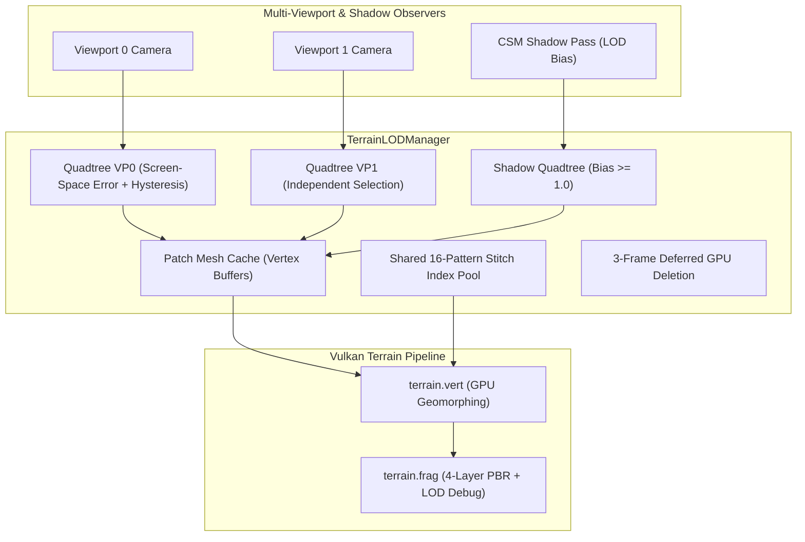

# SIDERA Engine — Milestone 23: Advanced Terrain LOD

**Engine Version:** `v0.23.0`  
**Milestone:** 23 — Advanced Terrain LOD  
**Branch:** `master`  
**Platform:** Windows 11 x64, Vulkan 1.3, C++20, CMake 3.31, MSVC 19.44  
**Primary Hardware:** NVIDIA GeForce RTX 4060 Laptop GPU (8GB VRAM)  

---

## 1. Executive Summary

Milestone 23 upgrades **SIDERA Engine**'s terrain rendering from a fixed static chunk grid to a dynamic, Unreal Engine-style **Quadtree Adaptive Terrain LOD System** with screen-space geometric error selection, GPU shader geomorphing, 1-level neighbor balancing, and 16-pattern crack-free edge stitching.

---

## 2. Architecture & Implemented Features

### 2.1 Quadtree Terrain Architecture (`src/terrain/TerrainQuadNode.h`, `TerrainQuadtree.{h,cpp}`)
- Dynamic root node covering normalized terrain domain `[0, 1] x [0, 1]`.
- Recursive 4-child subdivision (NW, NE, SW, SE) and dynamic merging back to parent without ever rendering parent and child simultaneously.
- Deterministic 64-bit node keys (`makeTerrainNodeKey(depth, gridX, gridZ)`) for $O(1)$ neighbor and cache lookups.

### 2.2 Adaptive Patch Generation & Shared Index Pool (`src/terrain/TerrainPatchMesh.{h,cpp}`)
- Configurable even patch resolution (`16x16` -> $17 \times 17$ verts default, `32x32` -> $33 \times 33$ verts on Ultra).
- All vertices sample the global `HeightmapData` continuously for exact height, normal, and UV continuity across patch boundaries.
- **Shared 16-Pattern Index Pool (`TerrainStitchIndexPool`)**: Pre-generates and uploads 16 device-local index buffers covering all 4-bit combinations of coarser North/South/East/West neighbors, shared across every patch in the world.

### 2.3 Screen-Space Geometric Error & Distance Fallback (`TerrainLODConfig.h`, `TerrainQuadtree.cpp`)
- Projects each node's world-space geometric error onto screen-space pixels:
  $$\text{screenError} = \frac{\text{geometricError} \cdot \text{viewportHeight}}{2 \cdot d \cdot \tan(\text{fovY} / 2)}$$
- Hysteresis deadband (`lodHysteresis = 0.75`) prevents split/merge oscillation.
- Distance-based fallback strategy (`TerrainLODStrategy::DistanceBased`) toggleable at runtime (`M` key) or via `--terrain-lod-strategy distance`.
- Quality presets: `Low`, `Medium`, `High`, `Ultra` (`--terrain-quality`).

### 2.4 GPU Geomorphing (`shaders/terrain.vert`, `TerrainPatchMesh.cpp`)
- Each patch vertex encodes its exact interpolated parent-surface height `parentWorldY` in `Vertex::color.x` and `morphMask` (`1.0` for odd vertices, `0.0` for even vertices shared with parent) in `Vertex::color.z`.
- `terrain.vert` smoothly interpolates `morphedPos.y = mix(inPosition.y, inColor.x, morphFactor * inColor.z)` on the GPU with zero per-frame CPU mesh regeneration.

### 2.5 Crack-Free Stitching & Neighbor Balancing (`TerrainNeighborData.h`, `TerrainPatchMesh.cpp`, `TerrainQuadtree.cpp`)
- Iterative quadtree balancing guarantees adjacent leaf nodes differ by at most 1 depth level (`|depthA - depthB| <= 1`).
- 4-bit `stitchMask` (`North | South | West | East`) selects the exact index pattern from `TerrainStitchIndexPool` that omits odd edge vertices on coarser boundaries and handles all 4 multi-edge corner combinations with 0 T-junctions and 100% CCW `+Y` winding.

### 2.6 Multi-Viewport, Shadows, World Partition, Streaming & Foliage
- **Multi-Viewport**: `TerrainLODManager` maintains an independent `TerrainQuadtree` per `viewportId`, sharing the cached patch vertex buffers and stitch index pool.
- **Shadow LOD**: Dedicated shadow quadtree evaluated with configurable `shadowLodBias` (default `1.5x`).
- **World Partition & Streaming**: Linked via `setWorldPartitionManager()` and `setWorldStreamingManager()`, preserving strict separation of concerns.
- **Foliage**: `Terrain::getHeightAt()` and `Terrain::getNormalAt()` sample global `HeightmapData` directly and remain 100% invariant under terrain LOD changes.

### 2.7 Debug Visualization & Telemetry
- `N` key cycles Terrain LOD Debug overlays (`Off` -> `LOD Colors` [L0 Red..L4 Blue] -> `Morph Factor Heatmap` -> `Stitching Highlight`) alongside 3D quadtree wireframe bounding boxes.
- CLI flags: `--terrain-lod-debug`, `--terrain-lod-strategy <screen|distance>`, `--terrain-quality <low|medium|high|ultra>`.
- Live HUD telemetry: `TERRAIN LOD: <vis>/<tot> patches, <tris> tris [L0:.. L1:.. L2:.. L3:.. Stitch:.. Err:..px]`.

---

## 3. Verification & Test Results

### 3.1 Advanced Terrain LOD Unit Tests (`test_terrain_lod.exe` — Release & Debug)
All **9 / 9** comprehensive unit test groups **PASSED (100%)** in both Release and Debug builds:
1. Quadtree root creation, subdivision, merge, max depth (`Near leaves=256, Far leaves=1`): **PASSED**
2. Screen-space error, FOV, viewport resolution, distance fallback: **PASSED**
3. LOD hysteresis anti-thrashing (0 transitions across 10 jitter frames): **PASSED**
4. Geomorphing endpoints & smooth progression (`0.75 -> 0.0`): **PASSED**
5. Neighbor balancing (`|depthA - depthB| <= 1`) & all 16 stitch topologies (0 T-junctions, 100% CCW): **PASSED**
6. Exact height, normal, and UV continuity across patch boundaries: **PASSED**
7. Multi-viewport independence (`VP0=256`, `VP1=46`) & Shadow LOD bias: **PASSED**
8. World Partition, World Streaming, and Foliage query invariance: **PASSED**
9. Rapid camera movement, repeated split/merge, & Ultra benchmark (60 frames in `262.61 ms`, `4.38 ms/frame` Release): **PASSED**

### 3.2 Full Engine Regression Suite
**63 / 63** unit tests across all 7 test targets **PASSED (100%)**:
- `test_terrain_lod`: 9/9
- `test_world_partition`: 10/10
- `test_world_streaming`: 10/10
- `test_foliage`: 8/8
- `test_terrain`: 8/8
- `test_lod`: 8/8
- `test_normal_audit`: 10/10

### 3.3 Runtime Smoke, Stress & Vulkan Validation
- `build\Release\sidera.exe --smoke-test --stats --terrain-lod-debug`: `EXIT_SUCCESS`
- `build\Release\sidera.exe --smoke-test --stats --stress-test`: `EXIT_SUCCESS` (`1,113,294` total triangles, `87/253` terrain patches / `44,544` terrain tris, GPU `2.94 ms`)
- `build\Debug\sidera.exe --smoke-test --stats --terrain-lod-debug`: `EXIT_SUCCESS`, **0 Vulkan validation errors**.

### 3.4 Known Limitations
- Desktop screenshot capture via `PIL.ImageGrab` could not run in the locked headless Windows session (`OSError: screen grab failed`); runtime rendering was verified directly on the RTX 4060 GPU via Release/Debug smoke tests and Vulkan validation layers.

---

## 4. Added & Modified Files

### Added
- `src/terrain/TerrainLODConfig.h`
- `src/terrain/TerrainLODStatistics.h`
- `src/terrain/TerrainNeighborData.h`
- `src/terrain/TerrainQuadNode.h`
- `src/terrain/TerrainPatchMesh.h` / `src/terrain/TerrainPatchMesh.cpp`
- `src/terrain/TerrainQuadtree.h` / `src/terrain/TerrainQuadtree.cpp`
- `src/terrain/TerrainLODManager.h` / `src/terrain/TerrainLODManager.cpp`
- `tests/test_terrain_lod.cpp`
- `docs/milestones/milestone_23_progress.md`
- `docs/milestones/milestone_23_advanced_terrain_lod.md`

### Modified
- `shaders/terrain.vert`, `shaders/terrain.frag`
- `src/terrain/Terrain.h`, `src/terrain/Terrain.cpp`, `src/terrain/TerrainRenderer.cpp`
- `src/renderer/Renderer.cpp`
- `src/core/Application.h`, `src/core/Application.cpp`, `src/main.cpp`
- `CMakeLists.txt`
