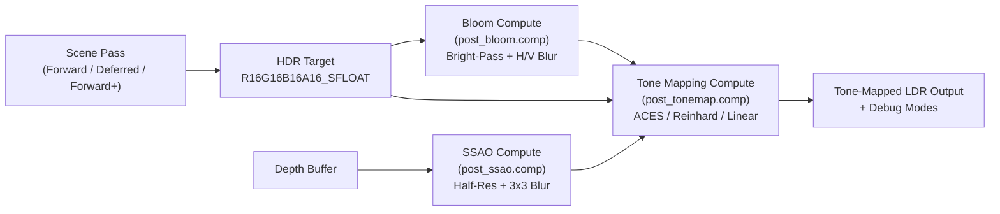

# SIDERA Engine — Milestone 29: Advanced Post Processing

**Version:** `v0.29.0`  
**Status:** Complete & Verified  
**Commit:** `feat(renderer): Milestone 29 — Advanced Post Processing`

---

## 1. Overview

Milestone 29 introduces a modular, GPU-driven **Advanced Post Processing** pipeline built on Vulkan 1.3 compute shaders and Synchronization2 barriers. It provides an HDR intermediate rendering target, physically-inspired Bloom, Screen-Space Ambient Occlusion (SSAO), Tone Mapping & Exposure control, and debug visualization modes, seamlessly integrated across **Forward**, **Deferred**, and **Forward+** rendering paths.

---

## 2. Architecture

### Key Components

| Component | Path | Responsibility |
| :--- | :--- | :--- |
| **Settings & CPU Reference** | `src/renderer/postprocess/PostProcessSettings.h` | `ToneMapOperator`, `PostProcessDebugMode`, `PostProcessSettings` (`validate()`, `getEffectiveExposure()`), `PostProcessStatistics`, and CPU reference math (`evalToneMapACES`, `evalToneMapReinhard`, `evalBrightPass`). |
| **Pipeline Manager** | `src/renderer/postprocess/PostProcessPipeline.h/.cpp` | Manages HDR target (`selectBestHDRFormat()`), half-res Bloom ping-pong targets, half-res SSAO raw/blur targets, linear sampler, descriptor sets, compute pipelines, resize, and `recordPasses()` with `vkCmdPipelineBarrier2`. |
| **Bloom Shader** | `shaders/post_bloom.comp` | Mode 0: Bright-pass extraction with soft threshold knee; Mode 1/2: 5-tap separable Gaussian blur (H/V); Mode 3: 4-tap tent upsample. |
| **SSAO Shader** | `shaders/post_ssao.comp` | Mode 0: Depth-based hemisphere sampling with golden-angle kernel, screen-space hash noise rotation, and range check; Mode 1: 3×3 denoise blur. |
| **Tone Mapping Shader** | `shaders/post_tonemap.comp` | Combines HDR scene, SSAO occlusion, and Bloom; applies effective exposure (`exposure * 2^EV`); supports ACES Filmic, Reinhard, Linear operators, and debug visualization (`Final`, `HDRScene`, `BloomOnly`, `SSAOOnly`). |
| **Renderer Integration** | `src/renderer/Renderer.h/.cpp` | Initializes `PostProcessPipeline` with swapchain extent, dispatches `recordPasses()` in `recordCommandBuffer()`, and cleans up in `destroyScene()`. |

---

## 3. HDR Format Fallback Strategy

`PostProcessPipeline::selectBestHDRFormat()` queries `vkGetPhysicalDeviceFormatProperties` for `VK_FORMAT_FEATURE_STORAGE_IMAGE_BIT | VK_FORMAT_FEATURE_SAMPLED_IMAGE_BIT` in priority order:

1. `VK_FORMAT_R16G16B16A16_SFLOAT` (preferred 64-bit HDR)
2. `VK_FORMAT_B10G11R11_UFLOAT_PACK32` (compact 32-bit HDR)
3. `VK_FORMAT_R8G8B8A8_UNORM` (universal LDR fallback)

---

## 4. Verification & Test Results

### Build Verification
- **Release Build** (`sidera.exe`, `test_advanced_post_processing.exe`, `post_bloom.comp.spv`, `post_ssao.comp.spv`, `post_tonemap.comp.spv`): **PASSED (0 errors)**
- **Debug Build** (`sidera.exe`, `test_advanced_post_processing.exe`, all SPIR-V shaders): **PASSED (0 errors)**

### Unit Tests (`test_advanced_post_processing`)
- **Release**: **3 / 3 PASSED**
- **Debug**: **3 / 3 PASSED**
  1. Settings defaults, clamping (`validate()`), and EV exposure calculation (`2^EV`).
  2. Tone mapping math (ACES monotonicity/boundedness, Reinhard `0.5` at `1.0`) and Bloom soft-knee bright-pass extraction.
  3. HDR format selection, resize dimension recalculation, and multi-viewport settings independence.

### GPU Runtime Smoke Tests (RTX 4060)
- `build/Release/sidera.exe --smoke-test --render-path forward`: **EXIT_SUCCESS (0)**
- `build/Release/sidera.exe --smoke-test --render-path deferred`: **EXIT_SUCCESS (0)**
- `build/Debug/sidera.exe --smoke-test --render-path forward-plus`: **EXIT_SUCCESS (0)**
