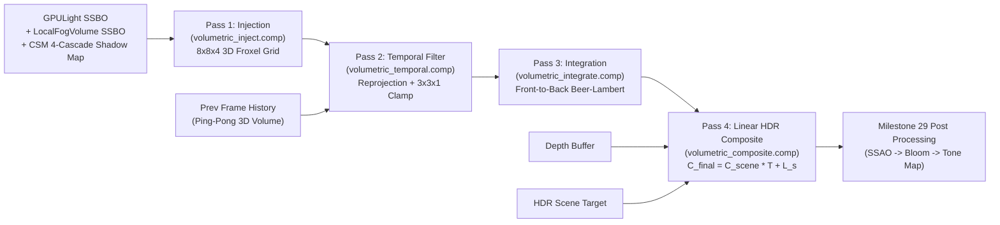

# SIDERA Engine — Milestone 30: Volumetric Rendering

**Version:** `v0.30.0`  
**Status:** Complete & Verified  
**Commit:** `feat(renderer): Milestone 30 — Volumetric Rendering`

---

## 1. Overview

Milestone 30 introduces a GPU-accelerated, **Froxel-Based Volumetric Rendering** pipeline built on Vulkan 1.3 compute shaders and Synchronization2 barriers. It provides height-based atmospheric fog, local volumetric fog volumes (Sphere & AABB), directional/point/spot light scattering with Henyey-Greenstein phase function, CSM-integrated volumetric shadows and light shafts, temporal reprojection with neighborhood clamping, front-to-back Beer-Lambert integration, and linear HDR composition prior to Bloom and Tone Mapping.

---

## 2. Pipeline Architecture

### Froxel Grid & Quality Presets

| Preset | XY Scale (px/froxel) | Depth Slices | 1920×1080 Froxel Grid | Total Froxels | 4× `RGBA16F` 3D Volume Memory |
| :--- | :---: | :---: | :---: | :---: | :---: |
| **Low** | 16 | 32 | 120 × 68 × 32 | 261,120 | ~8.0 MB |
| **Medium** (Default) | 16 | 64 | 120 × 68 × 64 | 522,240 | ~16.0 MB |
| **High** | 8 | 64 | 240 × 135 × 64 | 2,073,600 | ~63.3 MB |
| **Ultra** | 8 | 128 | 240 × 135 × 128 | 4,147,200 | ~126.6 MB |

- **Depth Distribution:** Logarithmic distribution $z(k) = z_{\text{near}} \cdot (z_{\text{max}} / z_{\text{near}})^{k/N}$ concentrates depth precision near the camera while covering open-world distances up to `maxDistance`.
- **Format & Limit Checks:** Queries `VkPhysicalDeviceLimits::maxImageDimension3D` and `vkGetPhysicalDeviceFormatProperties` (`VK_FORMAT_R16G16B16A16_SFLOAT` → `VK_FORMAT_R8G8B8A8_UNORM`).

---

## 3. Physically Motivated Scattering & Shadows

- **Height Fog:** $\rho(y) = \text{clamp}(\rho_0 \cdot \exp(-k_h \cdot \max(y - y_0, 0)), 0, \rho_{\max})$ plus additive local `LocalFogVolume` contributions (Sphere / AABB).
- **Phase Function:** Henyey-Greenstein $p(\cos\theta, g) = \frac{1 - g^2}{4\pi (1 + g^2 - 2g\cos\theta)^{3/2}}$ with $g \in [-0.95, 0.95]$.
- **Beer-Lambert Transmittance:** $T(d) = \exp(-\sigma_t \cdot d)$ with energy-conserving analytical slice integration $S = L_{\text{in}} \cdot \frac{1 - T(d)}{\sigma_t}$.
- **Lighting & Shadows:**
  - **Directional Lights:** Fully implemented with Henyey-Greenstein phase function and 4-cascade **CSM volumetric shadow sampling** (`u_csmShadowMap`) producing volumetric light shafts / god rays.
  - **Point & Spot Lights:** Fully implemented via `GPULight` SSBO with distance and inner/outer cone attenuation (unshadowed, as point/spot shadow maps are not present in the engine).
- **Temporal Reprojection:** Camera-based reprojection using `prevViewProj`, 3×3×1 neighborhood clamping, automatic camera-cut detection, resize invalidation, and per-viewport independent `ViewportVolumetricHistory`.

---

## 4. Verification Results

### Build Results
- **Release (`sidera.exe`, `test_volumetric_rendering.exe`, 4 SPIR-V shaders):** **PASSED (0 errors)**
- **Debug (`sidera.exe`, `test_volumetric_rendering.exe`, 4 SPIR-V shaders):** **PASSED (0 errors)**

### Unit & Regression Tests
- `build/Release/test_volumetric_rendering.exe`: **28 passed, 0 failed**
- `build/Debug/test_volumetric_rendering.exe`: **28 passed, 0 failed**
- `build/Release/test_advanced_post_processing.exe`: **3/3 PASSED** (M29 regression check)

### Six-Combination GPU Smoke Test Matrix (RTX 4060 Laptop GPU)
| Render Path | Build Config | Exit Code | Status |
| :--- | :--- | :---: | :---: |
| **Forward** | Release | `0` | **PASSED** |
| **Forward** | Debug | `0` | **PASSED** |
| **Deferred** | Release | `0` | **PASSED** |
| **Deferred** | Debug | `0` | **PASSED** |
| **Forward+** | Release | `0` | **PASSED** |
| **Forward+** | Debug | `0` | **PASSED** |

---

## 5. Known Limitations

- **Point/Spot Shadows:** Only directional lights receive volumetric shadows (via existing 4-cascade CSM); point and spot lights are unshadowed.
- **Temporal Motion Vectors:** Uses camera-based reprojection (`prevViewProj`); moving objects or animated local fog volumes without per-pixel velocity buffers rely on neighborhood clamping to limit ghosting.
- **Per-Pass GPU Timestamps:** The 4 volumetric compute passes execute within the main command buffer's GPU timestamp bracket; dedicated per-pass volumetric timestamp queries are not yet wired.
- **Visual Inspection:** Automated smoke tests verified clean Vulkan 1.3 execution and shutdown on RTX 4060 hardware; interactive visual inspection of fog/light-shaft aesthetics in a live viewport remains manual.
