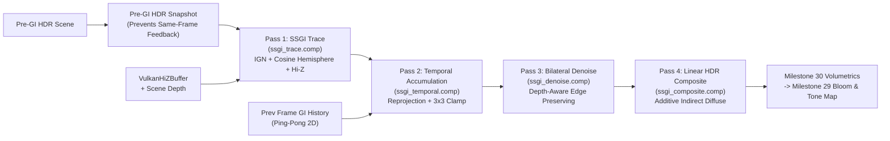

# SIDERA Engine — Milestone 31: Global Illumination

**Version:** `v0.31.0`  
**Status:** Complete & Verified  
**Commit:** `feat(renderer): Milestone 31 — Global Illumination`

---

## 1. Overview

Milestone 31 introduces a GPU-accelerated, real-time **Screen-Space Global Illumination (SSGI)** pipeline built on Vulkan 1.3 compute shaders and Synchronization2 barriers. It computes indirect diffuse lighting and dynamic color bleeding from visible scene radiance using stochastic cosine-weighted hemisphere sampling, hierarchical Hi-Z depth ray marching, temporal accumulation with neighborhood clamping, edge-aware bilateral denoising, and linear HDR composition prior to Volumetric Rendering (M30), Bloom, and Tone Mapping (M29).

---

## 2. Pipeline Architecture

### Quality Presets & GPU Memory (1920×1080, `RGBA16F`)

| Preset | Resolution Scale | GI Resolution | Rays/Pixel | Max Steps | Denoise Radius | GPU Memory (Pre-GI Copy + 4× GI) |
| :--- | :---: | :---: | :---: | :---: | :---: | :---: |
| **Low** | 0.25× | 480 × 270 | 2 | 12 | 1 | ~19.8 MB |
| **Medium** (Default) | 0.50× | 960 × 540 | 4 | 16 | 2 | ~31.6 MB |
| **High** | 0.50× | 960 × 540 | 6 | 24 | 2 | ~31.6 MB |
| **Ultra** | 0.75× | 1440 × 810 | 8 | 32 | 3 | ~51.4 MB |

---

## 3. Key Implementation Details

- **No Same-Frame Recursive Feedback:** `GlobalIlluminationPipeline::recordPasses()` copies the pre-GI HDR target into `m_preGiHdrCopy` before ray tracing so indirect radiance is strictly sampled from pre-GI linear HDR scene lighting.
- **Hi-Z Depth Reuse:** Reuses `Renderer::m_hizBuffers[m_currentFrame]` (`VulkanHiZBuffer`) for coarse hierarchical depth skipping before fine depth-thickness intersection testing.
- **Stochastic Sampling:** Uses per-pixel, frame-varied Interleaved Gradient Noise (IGN) with golden-ratio sequences for cosine-weighted hemisphere directions.
- **Temporal & Multi-Viewport Stability:** Per-viewport `ViewportGIHistory` map tracks `prevViewProj`, `prevCameraPos`, and ping-pong index independently with automatic camera-cut detection and resize invalidation.
- **Vulkan RT Capability Query:** `GlobalIlluminationPipeline::queryDeviceCapabilities()` queries `VK_KHR_acceleration_structure`, `VK_KHR_ray_tracing_pipeline`, `VK_KHR_ray_query`, and `VK_KHR_buffer_device_address` on the physical device for future RT/probe backend extensibility while keeping SSGI completely independent of hardware RT.

---

## 4. Verification Results

### Build Results
- **Release (`sidera.exe`, `test_global_illumination.exe`, 4 SPIR-V shaders):** **PASSED (0 errors)**
- **Debug (`sidera.exe`, `test_global_illumination.exe`, 4 SPIR-V shaders):** **PASSED (0 errors)**

### Unit & Regression Tests
- `build/Release/test_global_illumination.exe`: **38 passed, 0 failed**
- `build/Debug/test_global_illumination.exe`: **38 passed, 0 failed**
- `build/Release/test_advanced_post_processing.exe`: **3/3 PASSED** (M29 regression)
- `build/Release/test_volumetric_rendering.exe`: **28/28 PASSED** (M30 regression)

### Six-Combination GPU Smoke Test Matrix (RTX 4060 Laptop GPU)
| Render Path | Build Config | Exit Code | Status |
| :--- | :--- | :---: | :---: |
| **Forward** | Release | `0` | **PASSED** |
| **Forward** | Debug | `0` | **PASSED** |
| **Deferred** | Release | `0` | **PASSED** |
| **Deferred** | Debug | `0` | **PASSED** |
| **Forward+** | Release | `0` | **PASSED** |
| **Forward+** | Debug | `0` | **PASSED** |

---

## 5. Screen-Space & Known Limitations

- **Screen-Space Visibility:** SSGI can only gather indirect radiance from surfaces visible in the current camera frustum; off-screen and occluded geometry cannot contribute indirect light without a future world-space probe or hardware ray-tracing backend.
- **Temporal Motion Vectors:** Uses camera-based reprojection (`prevViewProj`); moving objects without per-pixel velocity buffers rely on 3×3 neighborhood clamping to limit ghosting.
- **Per-Pass GPU Timestamps & Visual Inspection:** SSGI compute passes execute inside the main command buffer's GPU timestamp bracket; dedicated per-pass GI GPU timestamp queries and live interactive visual inspection remain manual.
