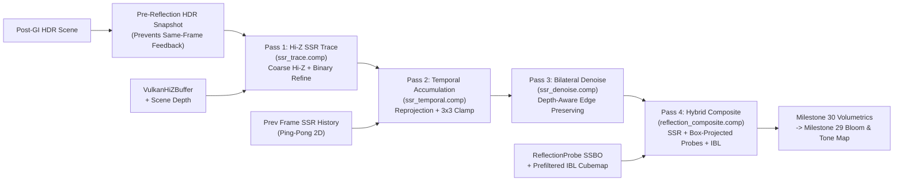

# SIDERA Engine — Milestone 32: Real-Time Reflection System

**Version:** `v0.32.0`  
**Status:** Complete & Verified  
**Commit:** `feat(renderer): Milestone 32 — Reflection System`

---

## 1. Overview

Milestone 32 introduces a **Hybrid Real-Time Reflection System** built on Vulkan 1.3 compute shaders and Synchronization2 barriers. It combines **Screen-Space Reflections (SSR)** with Hi-Z coarse-to-fine traversal and binary-search refinement, **Local Reflection Probes** with box-projected parallax correction and smooth influence blending, and **Global Prefiltered IBL Cubemap Fallback**, integrated with Fresnel-Schlick PBR response in linear HDR space prior to Volumetric Rendering (M30), Bloom, and Tone Mapping (M29).

---

## 2. Pipeline Architecture

### Quality Presets & GPU Memory (1920×1080, `RGBA16F`)

| Preset | Resolution Scale | SSR Resolution | Max Steps | Binary Refine | Denoise Radius | GPU Memory (Pre-Refl Copy + 4× SSR) |
| :--- | :---: | :---: | :---: | :---: | :---: | :---: |
| **Low** | 0.25× | 480 × 270 | 16 | 2 | 1 | ~19.8 MB |
| **Medium** (Default) | 0.50× | 960 × 540 | 24 | 4 | 2 | ~31.6 MB |
| **High** | 0.50× | 960 × 540 | 32 | 6 | 2 | ~31.6 MB |
| **Ultra** | 1.00× | 1920 × 1080 | 48 | 8 | 3 | ~79.1 MB |

---

## 3. Key Implementation Details

- **No Same-Frame Recursive Feedback:** Copies the pre-reflection HDR target into `m_preReflHdrCopy` before SSR tracing.
- **Hi-Z & Binary Refinement:** Reuses `Renderer::m_hizBuffers[m_currentFrame]` for coarse depth skipping, followed by configurable binary-search intersection refinement and screen-edge/distance/roughness confidence evaluation.
- **Local Reflection Probes & Box Projection:** `ReflectionProbe` (64-byte std430 SSBO, up to 64 probes) supports world-space position, influence radius, AABB min/max box-projection parallax correction, blend distance, priority, and intensity.
- **Global Environment Fallback:** Reuses `Renderer::m_iblMaps.prefilteredMap` (`VulkanCubemap`) with roughness-mapped mip sampling.
- **Multi-Viewport Independence:** Per-viewport `ViewportReflectionHistory` map prevents cross-viewport temporal contamination and automatically resets on camera cuts or resize.

---

## 4. Verification Results

### Build Results
- **Release (`sidera.exe`, `test_reflection_system.exe`, 4 SPIR-V shaders):** **PASSED (0 errors)**
- **Debug (`sidera.exe`, `test_reflection_system.exe`, 4 SPIR-V shaders):** **PASSED (0 errors)**

### Unit & Regression Tests
- `build/Release/test_reflection_system.exe`: **26 passed, 0 failed**
- `build/Debug/test_reflection_system.exe`: **26 passed, 0 failed**
- `build/Release/test_global_illumination.exe`: **38 passed, 0 failed** (M31 regression)
- `build/Release/test_volumetric_rendering.exe`: **28 passed, 0 failed** (M30 regression)
- `build/Release/test_advanced_post_processing.exe`: **3/3 PASSED** (M29 regression)

### Six-Combination GPU Smoke Test Matrix (RTX 4060 Laptop GPU)
| Render Path | Build Config | Exit Code | Status |
| :--- | :--- | :---: | :---: |
| **Forward** | Release | `0` | **PASSED** |
| **Forward** | Debug | `0` | **PASSED** |
| **Deferred** | Release | `0` | **PASSED** |
| **Deferred** | Debug | `0` | **PASSED** |
| **Forward+** | Release | `0` | **PASSED** |
| **Forward+** | Debug | `0` | **PASSED** |

---

## 5. Known Limitations

- **Dynamic Probe Capture:** Local reflection probes currently sample the shared prefiltered cubemap with per-probe box-projected parallax correction; per-probe 6-face dynamic render-to-cubemap capture is not yet implemented.
- **Temporal Motion Vectors:** Uses camera-based reprojection (`prevViewProj`); moving reflective/reflected objects rely on 3×3 neighborhood clamping to limit ghosting.
- **Per-Pass GPU Timestamps & Visual Inspection:** Reflection compute passes execute inside the main command buffer's GPU timestamp bracket; dedicated per-pass reflection GPU timestamp queries and live interactive visual inspection remain manual.
