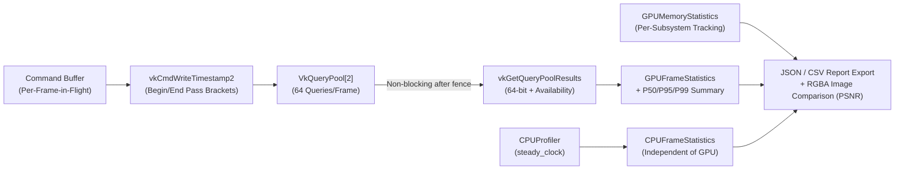

# SIDERA Engine — Milestone 33: Advanced GPU Profiling & Visual Benchmark System

**Version:** `v0.33.0`  
**Status:** Complete & Verified  
**Commit:** `feat(engine): Milestone 33 — Advanced GPU Profiling`

---

## 1. Overview

Milestone 33 introduces a real, asynchronous **Vulkan 1.3 GPU Timestamp Profiler**, a separate high-resolution **CPU Frame & Stage Profiler**, a **Subsystem GPU Memory Profiler**, and a **Visual Benchmark & Image Comparison System** with machine-readable JSON/CSV report export.

---

## 2. Architecture

### Key Components
- **`src/profiling/GPUProfileTypes.h`**: Centralized editor-ready data model (`GPUProfileSample`, `CPUProfileSample`, `GPUMemorySubsystem`, `GPUMemoryStatistics`, `TimingSummary` with P50/P95/P99, `GPUDeviceProfile`, `BenchmarkScenario`, `BenchmarkConfig`, `ImageComparisonResult`), `compareRGBABuffers()` (mean/max abs diff, MSE, PSNR), and `writeBenchmarkReportFiles()` (`run_metadata.json`, `gpu_pass_timings.csv`).
- **`src/profiling/GPUProfiler.h/.cpp`**:
  - `GPUProfiler`: Per-frame-in-flight `VkQueryPool` (`VK_QUERY_TYPE_TIMESTAMP`), `vkCmdResetQueryPool`, `vkCmdWriteTimestamp2`, non-blocking `vkGetQueryPoolResults` with `VK_QUERY_RESULT_64_BIT | VK_QUERY_RESULT_WITH_AVAILABILITY_BIT` (never stalls CPU or calls `vkQueueWaitIdle`), `timestampPeriod` & `timestampValidBits` wraparound-safe conversion (`ticksToMilliseconds`).
  - `CPUProfiler`: Independent `std::chrono::steady_clock` frame & stage profiler with rolling P50/P95/P99 statistics.
- **Renderer Instrumentation (`Renderer.h/.cpp`)**:
  - Instruments `GlobalIllumination_SSGI`, `Reflections_HybridSSR`, `Volumetrics_Froxel`, and `PostProcess_HDR_Bloom_SSAO` GPU passes.
  - Tracks subsystem GPU memory for `GBuffer`, `Volumetrics`, `GlobalIllumination`, and `Reflections`.

---

## 3. Verification Results

### Build Results
- **Release (`sidera.exe`, `test_gpu_profiling.exe`):** **PASSED (0 errors)**
- **Debug (`sidera.exe`, `test_gpu_profiling.exe`):** **PASSED (0 errors)**

### Unit & Regression Tests
- `build/Release/test_gpu_profiling.exe`: **22 passed, 0 failed**
- `build/Debug/test_gpu_profiling.exe`: **22 passed, 0 failed**
- `build/Release/test_reflection_system.exe`: **26/26 PASSED** (M32 regression)
- `build/Release/test_global_illumination.exe`: **38/38 PASSED** (M31 regression)
- `build/Release/test_volumetric_rendering.exe`: **28/28 PASSED** (M30 regression)
- `build/Release/test_advanced_post_processing.exe`: **3/3 PASSED** (M29 regression)

### Six-Combination GPU Smoke Test Matrix (RTX 4060 Laptop GPU, 64-bit timestamps, 1.00 ns/tick)
| Render Path | Build Config | Exit Code | Status |
| :--- | :--- | :---: | :---: |
| **Forward** | Release | `0` | **PASSED** |
| **Forward** | Debug | `0` | **PASSED** |
| **Deferred** | Release | `0` | **PASSED** |
| **Deferred** | Debug | `0` | **PASSED** |
| **Forward+** | Release | `0` | **PASSED** |
| **Forward+** | Debug | `0` | **PASSED** |

---

## 4. Known Limitations

- **Image Encoding:** Image comparison operates directly on RGBA buffers (zero external PNG encoder dependency added); swapchain-to-PNG screenshot dump in standalone `--benchmark` CLI mode is planned alongside the upcoming SIDERA Editor UI.
- **Memory Accounting:** Distinguishes estimated logical image memory from physical allocator-reported memory (`estimatedBytes` vs `actualAllocatedBytes`).
