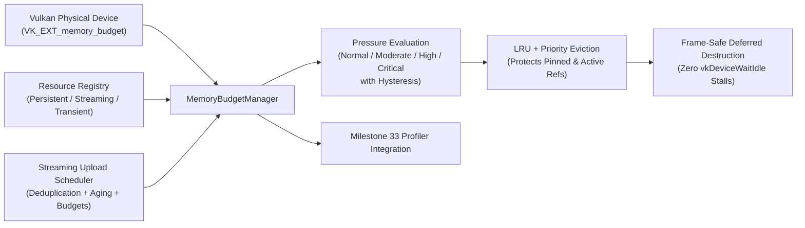

# SIDERA Engine — Milestone 34: Memory & Streaming Optimization

**Version:** `v0.34.0`  
**Status:** Complete & Verified  
**Commit:** `feat(engine): Milestone 34 — Memory & Streaming Optimization`

---

## 1. Overview

Milestone 34 introduces a centralized, budget-aware **Memory & Streaming Optimization** architecture (`MemoryBudgetManager`) that unifies CPU & GPU memory tracking, Vulkan `VK_EXT_memory_budget` physical heap querying, a resource residency registry, hysteresis-protected memory pressure evaluation, LRU+priority eviction, frame-safe deferred GPU resource destruction, and a deduplicated, priority-ordered, budget-bounded streaming upload scheduler.

---

## 2. Architecture

### Key Components
- **`src/memory/MemoryTypes.h`**: `MemoryPressureLevel`, `ResourceLifetimeClass` (`Persistent`, `Streaming`, `Transient`), `ResourceResidencyState` (`Unloaded`, `Queued`, `Loading`, `UploadPending`, `Resident`, `EvictionPending`, `Retiring`), `MemoryBudgetConfig`, `VulkanHeapBudget`, `ResourceRegistryEntry`, `StreamingUploadRequest`, and `MemoryOverviewStats`.
- **`src/memory/MemoryBudgetManager.h/.cpp`**:
  - **Vulkan Heap Budgets:** Queries `vkGetPhysicalDeviceMemoryProperties2` with `VkPhysicalDeviceMemoryBudgetPropertiesEXT` when `VK_EXT_memory_budget` is supported, falling back gracefully to `vkGetPhysicalDeviceMemoryProperties`.
  - **CPU & GPU Memory Accounting:** Tracks estimated vs. actual GPU bytes, CPU bytes, peak memory, allocation/deallocation counts, and lifetime class breakdowns.
  - **Pressure & Safe Eviction:** Evaluates pressure with configurable hysteresis (`evictionHysteresis`) to prevent load/unload oscillation; `selectEvictionCandidates()` protects `pinned`, `Persistent`, active-ref, and current-frame resources.
  - **Deferred GPU Destruction:** `deferDestruction()` + `processDeferredDestructions(completedFrame)` retires resources only after GPU completion (zero `vkDeviceWaitIdle` / `vkQueueWaitIdle` stalls).
  - **Streaming Upload Scheduler:** Deduplicates requests by `resourceId` (upgrading priority/pinning), supports cancellation, ages queued requests to prevent starvation, and throttles per-frame byte/op budgets under `High`/`Critical` memory pressure.
- **Renderer Integration (`Renderer.h/.cpp`)**: Initializes `m_memoryManager` with `VulkanDevice`, registers core persistent rendering subsystems (`GBuffer`, `Volumetrics`, `GlobalIllumination`, `Reflections`), and processes deferred destructions safely per frame.

---

## 3. Verification Results

### Build Results
- **Release (`sidera.exe`, `test_memory_streaming.exe`):** **PASSED (0 errors)**
- **Debug (`sidera.exe`, `test_memory_streaming.exe`):** **PASSED (0 errors)**

### Unit & Regression Tests
- `build/Release/test_memory_streaming.exe`: **22 passed, 0 failed**
- `build/Debug/test_memory_streaming.exe`: **22 passed, 0 failed**
- `build/Release/test_gpu_profiling.exe`: **22/22 PASSED** (M33 regression)
- `build/Release/test_reflection_system.exe`: **26/26 PASSED** (M32 regression)
- `build/Release/test_global_illumination.exe`: **38/38 PASSED** (M31 regression)
- `build/Release/test_volumetric_rendering.exe`: **28/28 PASSED** (M30 regression)
- `build/Release/test_advanced_post_processing.exe`: **3/3 PASSED** (M29 regression)

### Six-Combination GPU Smoke Test Matrix (RTX 4060 Laptop GPU)
| Render Path | Build Config | Exit Code | Status |
| :--- | :--- | :---: | :---: |
| **Forward** | Release | `0` | **PASSED** |
| **Forward** | Debug | `0` | **PASSED** |
| **Deferred** | Release | `0` | **PASSED** |
| **Deferred** | Debug | `0` | **PASSED** |
| **Forward+** | Release | `0` | **PASSED** |
| **Forward+** | Debug | `0` | **PASSED** |

---

## 4. Known Limitations

- **Logical vs. Physical Allocation Accounting:** Tracks engine-estimated logical sizes alongside Vulkan device-level `VK_EXT_memory_budget` heap usage; exact per-suballocation physical sizes depend on a future VMA integration if adopted.
- **Standalone Stress Harness:** Automated unit tests verify pressure transitions, eviction protection, deferred retirement, deduplication, and budget throttling; long-duration open-world streaming stress benchmarks remain manual.
