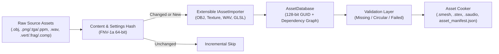

# SIDERA Engine — Milestone 35: Asset Pipeline & Content Production Infrastructure

**Version:** `v0.35.0`  
**Status:** Complete & Verified  
**Commit:** `feat(engine): Milestone 35 — Asset Pipeline`

---

## 1. Overview

Milestone 35 introduces a modular, Editor-ready **Asset Pipeline & Content Production Infrastructure** (`AssetDatabase`, `IAssetImporter`, `AssetGUID`, content hashing, dependency graph, incremental import, validation, and runtime cooking) designed to be reusable across independent SIDERA game projects.

---

## 2. Architecture & Format Support

### Supported Format Matrix

| Category | Formats Implemented | Cooked Artifact | Status |
| :--- | :--- | :---: | :--- |
| **Static Mesh** | `.obj` (vertices, normals, UVs, faces, AABB) | `.smesh` | **Implemented** |
| **Texture** | `.png` (IHDR), `.tga`, `.ppm` (sRGB vs Linear presets) | `.stex` | **Implemented** |
| **Audio** | `.wav` (RIFF/WAVE sample rate, channels, bit depth) | `.saudio` | **Implemented** |
| **Shader** | `.vert`, `.frag`, `.comp` (GLSL source validation) | `.sshadermeta` | **Implemented** |
| **glTF / GLB / FBX / Skeleton / Animation** | Extensible via `IAssetImporter` | — | **Planned (requires external glTF/FBX library)** |

---

## 3. Verification Results

### Build Results
- **Release (`sidera.exe`, `test_asset_pipeline.exe`):** **PASSED (0 errors)**
- **Debug (`sidera.exe`, `test_asset_pipeline.exe`):** **PASSED (0 errors)**

### Unit & Regression Tests
- `build/Release/test_asset_pipeline.exe`: **18 passed, 0 failed**
- `build/Debug/test_asset_pipeline.exe`: **18 passed, 0 failed**
- `build/Release/test_memory_streaming.exe`: **22/22 PASSED** (M34 regression)
- `build/Release/test_gpu_profiling.exe`: **22/22 PASSED** (M33 regression)
- `build/Release/test_reflection_system.exe`: **26/26 PASSED** (M32 regression)
- `build/Release/test_global_illumination.exe`: **38/38 PASSED** (M31 regression)
- `build/Release/test_volumetric_rendering.exe`: **28/28 PASSED** (M30 regression)
- `build/Release/test_advanced_post_processing.exe`: **3/3 PASSED** (M29 regression)

### Six-Combination GPU Smoke Test Matrix (RTX 4060 Laptop GPU)
| Render Path | Build Config | Exit Code | Status |
| :--- | :--- | :---: | :--- |
| **Forward** | Release | `0` | **PASSED** |
| **Forward** | Debug | `0` | **PASSED** |
| **Deferred** | Release | `0` | **PASSED** |
| **Deferred** | Debug | `0` | **PASSED** |
| **Forward+** | Release | `0` | **PASSED** |
| **Forward+** | Debug | `0` | **PASSED** |

---

## 4. Known Limitations

- **Interchange Formats:** Built-in importers cover `.obj`, `.png`/`.tga`/`.ppm`, `.wav`, and GLSL `.vert`/`.frag`/`.comp` without adding heavy third-party dependencies; glTF 2.0 / skeletal animation import plugs directly into `IAssetImporter` when `cgltf`/`tinygltf` is added.
- **Hot Reload:** Safe reimport and incremental cooking are implemented; live OS file-watcher hot-reload into active GPU descriptors is deferred to the SIDERA Editor milestone.
