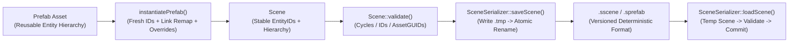

# SIDERA Engine — Milestone 36: Scene Serialization & Prefab System

**Version:** `v0.36.0`  
**Status:** Complete & Verified  
**Commit:** `feat(engine): Milestone 36 — Scene Serialization & Prefab System`

---

## 1. Overview

Milestone 36 introduces a versioned, transactional **Scene Serialization & Prefab System** (`Scene`, `SceneEntity`, `TransformComponent`, `ComponentRecord`, `Prefab`, `PrefabOverride`, `SceneSerializer`) integrated with Milestone 35's `AssetDatabase` and `AssetGUID`. It enables deterministic saving, transactional loading, parent-child hierarchy validation, reusable Prefab instantiation, and per-instance Prefab overrides.

---

## 2. Architecture

### Key Components
- **`src/scene/SceneTypes.h`**: `EntityID` (stable 64-bit IDs, never array indices), `TransformComponent` (`position`, `rotationEulerDeg`, `scale`, `computeLocalMatrix()`), extensible `ComponentRecord` (preserves unknown future components safely), `PrefabOverride`, `SceneEntity`, and `SceneValidationIssue`.
- **`src/scene/Scene.h/.cpp`**: `Scene` with `AssetGUID`, `kCurrentSchemaVersion = 1`, `std::map<EntityID, SceneEntity>` (deterministic ordering), cycle-rejecting `setParent()`, `computeWorldMatrix()`, `collectAssetDependencies()`, and `validate(const AssetDatabase*)`.
- **`src/scene/SceneSerializer.h/.cpp`**:
  - **Transactional Saving:** Writes to `.tmp`, flushes, validates stream state, and atomically replaces the target file.
  - **Transactional Loading:** Parses into a temporary `Scene`, validates schema version and hierarchy, and only commits to `outScene` on full success (preserving the previous active scene on any failure).
  - **Prefab System:** `savePrefab`, `loadPrefab`, `instantiatePrefab` (assigns unique `EntityID`s, remaps internal parent-child links, applies `PrefabOverride`s), `revertOverride`, and `revertAllOverrides`.

---

## 3. Verification Results

### Build Results
- **Release (`sidera.exe`, `test_scene_serialization.exe`):** **PASSED (0 errors)**
- **Debug (`sidera.exe`, `test_scene_serialization.exe`):** **PASSED (0 errors)**

### Unit & Regression Tests
- `build/Release/test_scene_serialization.exe`: **24 passed, 0 failed**
- `build/Debug/test_scene_serialization.exe`: **24 passed, 0 failed**
- `build/Release/test_asset_pipeline.exe`: **18/18 PASSED** (M35 regression)
- `build/Release/test_memory_streaming.exe`: **22/22 PASSED** (M34 regression)
- `build/Release/test_gpu_profiling.exe`: **22/22 PASSED** (M33 regression)
- `build/Release/test_reflection_system.exe`: **26/26 PASSED** (M32 regression)
- `build/Release/test_global_illumination.exe`: **38/38 PASSED** (M31 regression)
- `build/Release/test_volumetric_rendering.exe`: **28/28 PASSED** (M30 regression)
- `build/Release/test_advanced_post_processing.exe`: **3/3 PASSED** (M29 regression)

### Six-Combination GPU Smoke Test Matrix (RTX 4060 Laptop GPU)
| Render Path | Build Config | Exit Code | Status |
| :--- | :--- | :---: | :--- |
| **Forward** | Release | `0` | **PASSED** |
| **Forward** | Debug | `0` | **PASSED** |
| **Deferred** | Release | `0` | **PASSED** |
| **Deferred** | Debug | `0` | **PASSED** |
| **Forward+** | Release | `0` | **PASSED** |
| **Forward+** | Debug | `0` | **PASSED** |

---

## 4. Known Limitations

- **Nested Prefab Inheritance:** Single-level Prefab hierarchies with multi-entity parent-child trees and per-instance overrides are fully implemented; multi-level Prefab variant inheritance chains are deferred to the SIDERA Editor milestone.
- **Historical Schema Migrations:** Schema version `1` is the initial scene format; unsupported future versions (`> 1`) are cleanly rejected while preserving the active scene.
