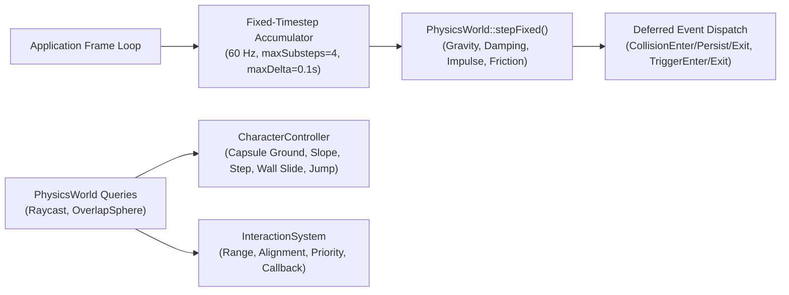

# SIDERA Engine — Milestone 37: Physics, Character Controller & Interaction Foundation

**Version:** `v0.37.0`  
**Status:** Complete & Verified  
**Commit:** `feat(engine): Milestone 37 — Physics Integration`

---

## 1. Overview

Milestone 37 introduces a reusable, game-agnostic **3D Physics, Character Controller & Interaction Foundation** (`PhysicsWorld`, `CharacterController`, `InteractionSystem`) keyed by stable Milestone 36 `EntityID`s, using fixed-timestep simulation with accumulator clamping, collision layer/mask filtering, impulse-based restitution & friction, deferred collision/trigger events, raycast/overlap queries, and capsule-based character locomotion.

---

## 2. Architecture

### Key Components
- **`src/physics/PhysicsTypes.h`**: `RigidBodyType` (`Static`, `Dynamic`, `Kinematic`), `ColliderShapeType` (`Box`, `Sphere`, `Capsule`, `Plane`), `PhysicsMaterial` (`staticFriction`, `dynamicFriction`, `restitution`), `CollisionFilter` (32-bit layer & mask), `ColliderDesc`, `RigidBodyDesc`, `PhysicsSettings`, `RaycastHit`, `PhysicsEvent`, `PhysicsStatistics`, and `InteractableRecord`.
- **`src/physics/PhysicsWorld.h/.cpp`**:
  - `PhysicsWorld`: Fixed-timestep simulation, duplicate-body protection per `EntityID`, safe contact cleanup on body removal, Plane/Sphere/Box/Capsule collision detection with impulse resolution + friction, deferred Enter/Persist/Exit event dispatch, `raycast()` (layer-filtered, trigger-aware), and `overlapSphere()`.
  - `CharacterController`: Capsule-based locomotion with ground detection, slope limit, step offset, wall-collision sliding, gravity/falling, `jump()`, and `teleport()`.
  - `InteractionSystem`: Game-agnostic interactable registration, range + view-alignment + priority target selection, and callback dispatch.

---

## 3. Verification Results

### Build Results
- **Release (`sidera.exe`, `test_physics_integration.exe`):** **PASSED (0 errors)**
- **Debug (`sidera.exe`, `test_physics_integration.exe`):** **PASSED (0 errors)**

### Unit & Regression Tests
- `build/Release/test_physics_integration.exe`: **15 passed, 0 failed**
- `build/Debug/test_physics_integration.exe`: **15 passed, 0 failed**
- M29–M36 Regressions: `test_scene_serialization` (24/24), `test_asset_pipeline` (18/18), `test_memory_streaming` (22/22), `test_gpu_profiling` (22/22), `test_reflection_system` (26/26), `test_global_illumination` (38/38), `test_volumetric_rendering` (28/28), `test_advanced_post_processing` (3/3) — **ALL PASSED**.

### Six-Combination GPU Smoke Test Matrix (RTX 4060 Laptop GPU)
| Render Path | Build Config | Exit Code | Status |
| :--- | :--- | :---: | :--- |
| **Forward** | Release | `0` | **PASSED** |
| **Forward** | Debug | `0` | **PASSED** |
| **Deferred** | Release | `0` | **PASSED** |
| **Deferred** | Debug | `0` | **PASSED** |
| **Forward+** | Release | `0` | **PASSED** |
| **Forward+** | Debug | `0` | **PASSED** |

---

## 4. Known Limitations

- **Physics Backend:** Uses a deterministic, zero-dependency built-in 3D rigid-body & query backend isolated behind `PhysicsWorld`; swapping in JoltPhysics / PhysX for convex hulls, arbitrary triangle meshes, and joints requires no changes to Engine Core consumers.
- **Physics Debug Wireframes:** Debug drawing toggle is exposed in `PhysicsSettings`; viewport wireframe line rendering will be wired into the upcoming SIDERA Editor gizmo pass.
