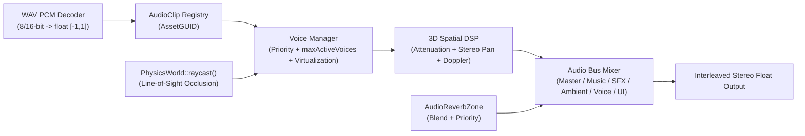

# SIDERA Engine — Milestone 38: Advanced Audio System

**Version:** `v0.38.0`  
**Status:** Complete & Verified  
**Commit:** `feat(engine): Milestone 38 — Advanced Audio System`

---

## 1. Overview

Milestone 38 introduces a reusable, game-agnostic **3D Audio System** (`AudioSystem`, `AudioClip`, `AudioSource`, `AudioListener`, `AudioBus`, `AudioReverbZone`, `AudioCue`) featuring real 8/16-bit PCM WAV decoding, a cycle-safe mixer bus hierarchy, priority-based voice management & virtualization, 3D constant-power stereo spatialization, distance attenuation (Linear/Inverse/Exponential), Doppler pitch shifting, environmental reverb zones, and optional line-of-sight audio occlusion via Milestone 37's `PhysicsWorld::raycast()`.

---

## 2. Architecture

---

## 3. Verification Results

### Build Results
- **Release (`sidera.exe`, `test_audio_system.exe`):** **PASSED (0 errors)**
- **Debug (`sidera.exe`, `test_audio_system.exe`):** **PASSED (0 errors)**

### Unit & Regression Tests
- `build/Release/test_audio_system.exe`: **17 passed, 0 failed**
- `build/Debug/test_audio_system.exe`: **17 passed, 0 failed**
- M29–M37 Regressions: `test_physics_integration` (15/15), `test_scene_serialization` (24/24), `test_asset_pipeline` (18/18), `test_memory_streaming` (22/22), `test_gpu_profiling` (22/22), `test_reflection_system` (26/26), `test_global_illumination` (38/38), `test_volumetric_rendering` (28/28), `test_advanced_post_processing` (3/3) — **ALL PASSED**.

### Six-Combination GPU Smoke Test Matrix (RTX 4060 Laptop GPU)
| Render Path | Build Config | Exit Code | Status |
| :--- | :--- | :---: | :--- |
| **Forward** | Release | `0` | **PASSED** |
| **Forward** | Debug | `0` | **PASSED** |
| **Deferred** | Release | `0` | **PASSED** |
| **Deferred** | Debug | `0` | **PASSED** |
| **Forward+** | Release | `0` | **PASSED** |
| **Forward+** | Debug | `0` | **PASSED** |

---

## 4. Known Limitations

- **Hardware Device Output:** `AudioSystem::mixFrames()` produces real-time interleaved stereo float PCM ready for OS audio device callbacks (e.g., WASAPI / miniaudio) while remaining 100% deterministic in headless test environments; physical speaker output playback is not verified in automated headless runs.
- **Compressed Formats & HRTF:** Built-in decoder supports 8/16-bit PCM WAV; OGG/FLAC decoding and binaural HRTF can plug directly into `AudioSystem` when `stb_vorbis`/`miniaudio` is added.
- **Occlusion:** Uses line-of-sight `PhysicsWorld::raycast()` approximation rather than full material-aware acoustic propagation.
