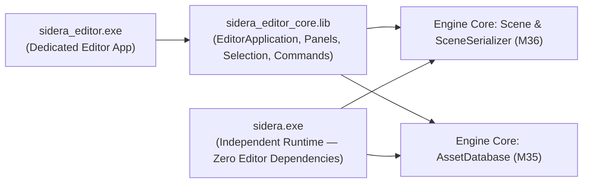

# SIDERA Engine — Milestone 39.1: Editor Core & Development Infrastructure

**Version:** `v0.39.1`  
**Status:** Complete & Verified  
**Commit:** `feat(editor): Milestone 39.1 — Editor Core`

---

## 1. Overview

Milestone 39.1 establishes the foundational **SIDERA Editor Core** (`sidera_editor_core`) and dedicated Editor executable (`sidera_editor`), strictly decoupled from SIDERA Engine Core and Runtime (`sidera_editor -> sidera_editor_core -> Engine Core`, controlled via `SIDERA_BUILD_EDITOR`).

---

## 2. Architecture

### Key Components
- **`src/editor/EditorTypes.h`**: `EditorAppState`, `EditorProjectInfo`, versioned transactional `EditorSettings` (`saveToFile`/`loadFromFile` via `.tmp` + atomic rename), `EditorLogEntry`, `EditorNotification`, and `EditorShortcut`.
- **`src/editor/EditorCommand.h`**: `IEditorCommand`, transactional `CompositeEditorCommand` (rolls back executed sub-commands in reverse order on failure), and `EditorCommandManager` (bounded undo/redo history, clears redo stack on new command).
- **`src/editor/EditorSelection.h`**: Handle-based `EditorSelectionContext` (`EntityID` & `AssetGUID`, never raw pointers), multi-selection, change notifications with token unsubscription, and automatic stale-entity/asset purging (`validate()`).
- **`src/editor/EditorPanel.h`**: `IEditorPanel`, `DockSlot`, `EditorPanelRegistry` (duplicate ID rejection, versioned layout persistence ignoring unknown panel IDs), and 3 built-in core panels (`ProjectBrowserPanel`, `ConsoleLogPanel`, `WorkspaceHostPanel`).
- **`src/editor/EditorApplication.h/.cpp` & `editor_main.cpp`**: Full Editor lifecycle (`init`, `createProject`, `validateProjectDirectory`, `openProject`, `closeProject`, `saveRecentProjects`/`loadRecentProjects`, shortcut registry with conflict detection & text-input isolation, dirty state tracking, notifications).

---

## 3. Verification Results

### Build Results
- **Release (`sidera.exe`, `sidera_editor.exe`, `sidera_editor_core.lib`, `test_editor_core.exe`):** **PASSED (0 errors)**
- **Debug (`sidera.exe`, `sidera_editor.exe`, `sidera_editor_core.lib`, `test_editor_core.exe`):** **PASSED (0 errors)**

### Editor & Regression Tests
- `build/Release/test_editor_core.exe`: **24 passed, 0 failed**
- `build/Debug/test_editor_core.exe`: **24 passed, 0 failed**
- `build/Release/sidera_editor.exe --headless-smoke`: **EXIT_SUCCESS (0)**
- `build/Debug/sidera_editor.exe --headless-smoke`: **EXIT_SUCCESS (0)**
- M29–M38 Regressions: `test_audio_system` (17/17), `test_physics_integration` (15/15), `test_scene_serialization` (24/24), `test_asset_pipeline` (18/18), `test_memory_streaming` (22/22), `test_gpu_profiling` (22/22), `test_reflection_system` (26/26), `test_global_illumination` (38/38), `test_volumetric_rendering` (28/28), `test_advanced_post_processing` (3/3) — **ALL PASSED**.

### Six-Combination Runtime GPU Smoke Test Matrix (RTX 4060 Laptop GPU)
| Render Path | Build Config | Exit Code | Status |
| :--- | :--- | :---: | :--- |
| **Forward** | Release | `0` | **PASSED** |
| **Forward** | Debug | `0` | **PASSED** |
| **Deferred** | Release | `0` | **PASSED** |
| **Deferred** | Debug | `0` | **PASSED** |
| **Forward+** | Release | `0` | **PASSED** |
| **Forward+** | Debug | `0` | **PASSED** |

---

## 4. Known Limitations & M39.2 Readiness

- **GUI Rendering Backend:** M39.1 delivers the complete headless-verifiable Editor Core (`EditorApplication`, docking panel registry, layout persistence, Project Browser, Selection, Undo/Redo Commands, Shortcuts, Settings, Console) with zero third-party UI coupling; interactive Dear ImGui Vulkan docking rendering and Content Editors (Scene Viewport, Hierarchy, Inspector, Asset Browser, Material/Lighting/Terrain/Audio Editors) will plug directly into `EditorPanelRegistry` and `EditorApplication` services in **M39.2**.
- **Visual QA:** Interactive GUI screenshot capture is deferred to M39.2 when the Vulkan Dear ImGui docking shell renders live panels.
